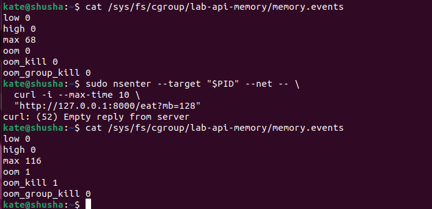
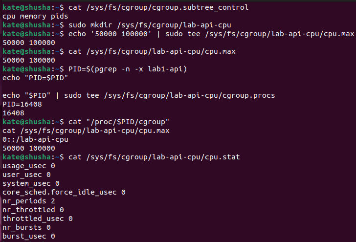
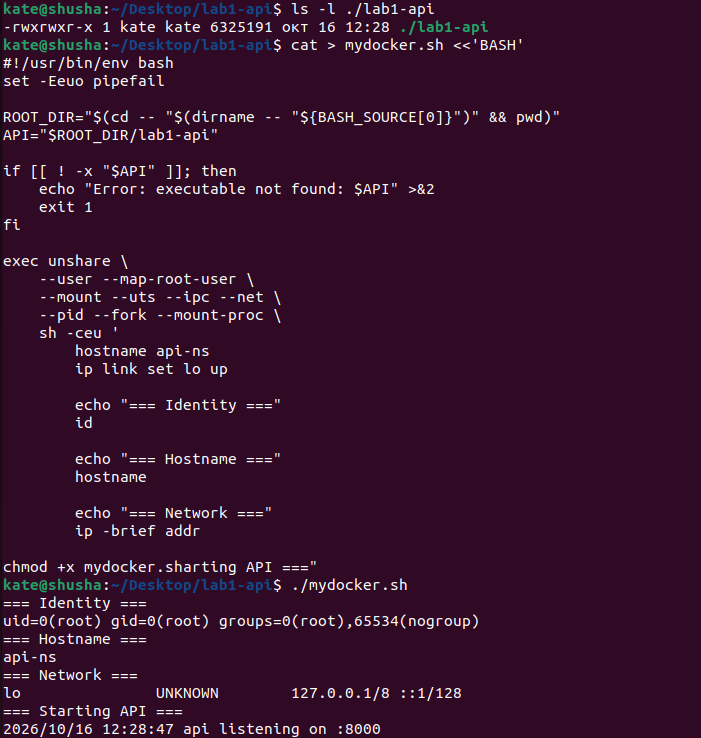
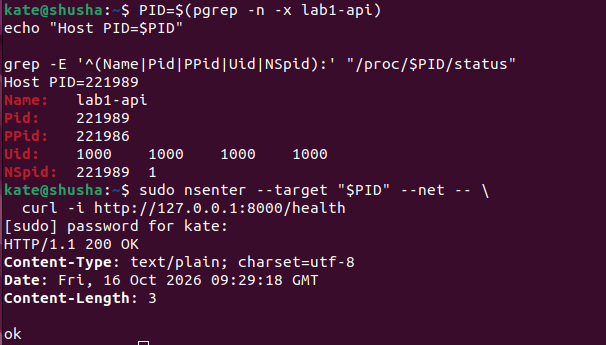
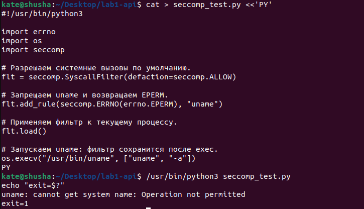
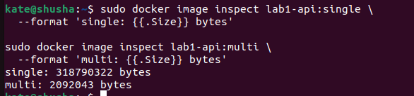

# Лабораторная работа — основы изоляции контейнеров в Linux (Namespaces, Cgroups, Seccomp, Capabilities)

## Ситуация

Современные контейнеры (Docker, containerd, Kubernetes поды) не являются полноценными виртуальными машинами — это обычные процессы операционной системы Linux, изолированные с помощью встроенных механизмов ядра. Цель данной работы — последовательно разобрать и воспроизвести базовые примитивы контейнеризации «снизу вверх»: изолировать видимость процессов через шесть типов пространств имён (Namespaces), установить жесткие лимиты ресурсов через Cgroups v2 (память, троттлинг CPU, число процессов), урезать системные привилегии с помощью Linux Capabilities и фильтрации системных вызовов Seccomp, разработать собственный bash-лаунчер `mydocker.sh`, а также исследовать оптимизацию слоёв образов и песочницу `gVisor` (runsc).

Эксперименты проводились в виртуальной машине под управлением Ubuntu 22.04 LTS (ядро 5.15) со смонтированной файловой системой Cgroups v2 (`/sys/fs/cgroup`). В качестве исследуемого приложения использовался специально подготовленный микросервис `api` на языке Go, содержащий методы для управляемого выделения памяти и загрузки процессора.

## Часть 1 — Запуск и исследование процесса

Для исследования характеристик процесса сервиса до наложения каких-либо ограничений микросервис был запущен в фоновом режиме. Приложение слушает порт 8000 и предоставляет набор тестовых эндпоинтов:

| Endpoint | Что делает | Зачем нужен в лабораторной работе |
| :--- | :--- | :--- |
| `GET /health` | Возвращает HTTP 200 и строку `ok` | Проверка доступности сервиса до и после наложения ограничений |
| `GET /eat?mb=N` | Аллоцирует и удерживает в RAM `N` MiB памяти | Исследование лимитов cgroups, вытеснения в swap и срабатывания OOM Killer |
| `GET /burn` | Запускает бесконечный цикл вычислений на CPU | Проверка процессорных квот cgroups v2 и фиксация троттлинга |

```bash
# Запуск сервиса API на Go
go run main.go &

# Проверка прослушиваемого порта и PID процесса
sudo ss -ltnp 'sport = :8000'
ps -o pid,ppid,user,uid,gid,stat,cmd -p 11497
```


На снимке экрана зафиксирован успешный запуск сервиса на порту 8000. Команда `ss` подтверждает, что сокет открыт процессом с PID 11497, а вывод `ps` демонстрирует, что процесс запущен от непривилегированного пользователя `kate` (UID 1000, GID 1000) и находится в контексте родительского шелла (PPID 11458). Сервис отвечает кодом `200 OK` на вызов `/health`.

## Часть 2 — Namespaces: собственное представление системы

Пространства имён (Namespaces) ядра Linux не ограничивают объем доступных вычислительных ресурсов — они создают для процесса изолированное «зрение», подменяя глобальные таблицы ядра персональными представлениями. В работе исследовались шесть фундаментальных типов namespaces:

| Namespace | Что изолирует | Что проверялось в лабораторной работе |
| :--- | :--- | :--- |
| `pid` | Дерево процессов и нумерацию PID | Внутри пространства имён процесс получает `PID 1` и не видит процессов хоста |
| `user` | Отображение UID/GID и область привилегий | Внутри namespace процесс видит себя `root` (UID 0), оставаясь UID 1000 на хосте |
| `mnt` | Таблицу точек монтирования файловых систем | Изоляция точек монтирования; создание собственной виртуальной ФС `/proc` |
| `net` | Сетевой стек, интерфейсы, маршруты и сокеты | Внутри доступен только собственный loopback-интерфейс `lo`; сеть хоста изолирована |
| `uts` | Имя хоста (hostname) и NIS domain name | Установка персонального hostname `api-ns`, не влияющего на имя хоста |
| `ipc` | Очереди сообщений POSIX/SysV, семафоры и shm | Разделение разделяемой памяти и межпроцессного взаимодействия |

Для изоляции процесса использовалась системная утилита `unshare`, которая создает новые пространства имён, монтирует персональный `/proc` и заменяет текущий шелл процессом API:

```bash
# Запуск с изоляцией пространств имён
sudo unshare --pid --net --uts --ipc --mount-proc --fork /bin/bash

# Проверка состояния изнутри изолированного окружения
hostname api-ns
id
ip -brief addr
ps -ef
```


Снимок экрана подтверждает полную изоляцию: внутри namespace имя хоста изменилось на `api-ns`, команда `id` возвращает `uid=0(root)`, сетевой стек содержит только интерфейс `lo` с адресом `127.0.0.1/8`, а вывод `ps -ef` показывает, что процесс сервиса стал `PID 1`. При проверке из хостового окружения через `/proc/<PID>/status` поле `NSpid` содержит значение `12352 1`, что наглядно доказывает трансляцию одного и того же процесса: на хосте он имеет PID 12352, а внутри контейнера — PID 1. Проверка доступности сети через `nsenter --target $PID --net` возвращает успешный ответ `200 OK`.

### Вывод по namespaces

Namespaces меняют то, что процесс видит вокруг себя — дерево процессов, сетевые адаптеры, имя машины, точки монтирования и очереди IPC. Однако namespaces сами по себе не способны предотвратить исчерпание памяти или полную утилизацию ядер CPU, для чего требуется отдельный механизм контроля ресурсов.

## Часть 3 — Cgroups v2: жесткие ограничения ресурсов

Для управления потреблением аппаратных ресурсов задействована подсистема Control Groups v2. В единой иерархии `/sys/fs/cgroup` была создана контрольная группа `lab-api-memory`, куда помещался PID процесса.

### Ограничение оперативной памяти и OOM Killer

Сначала лимит памяти был установлен в 64 MiB (`memory.max = 67108864`), при этом пространство подкачки (swap) оставалось доступным по умолчанию:

```bash
sudo mkdir -p /sys/fs/cgroup/lab-api-memory
echo 67108864 | sudo tee /sys/fs/cgroup/lab-api-memory/memory.max
echo $API_PID | sudo tee /sys/fs/cgroup/lab-api-memory/cgroup.procs

# Запрос на аллокацию 128 MiB памяти
curl -i 'http://localhost:8000/eat?mb=128'
```

При первичном тесте сервис успешно выделил 128 MiB. Анализ счётчиков `memory.swap.current` и `/proc/$PID/status` (поле `VmSwap`) показал, что ядро не завершило процесс, а вытеснило избыточные страницы из RAM в файл подкачки swap. Чтобы зафиксировать чистое срабатывание защиты по памяти, swap для группы был принудительно отключен (`echo 0 > memory.swap.max`). Повторный запрос немедленно спровоцировал срабатывание Out-Of-Memory Killer ядра Linux.



На снимке экрана видно, что после исчерпания жесткого лимита 64 MiB процесс API был мгновенно принудительно завершен сигналом SIGKILL. В файле `/sys/fs/cgroup/lab-api-memory/memory.events` значение счетчика `oom_kill` увеличилось до `1`, а кольцевой буфер `dmesg` зафиксировал системное сообщение `Memory cgroup out of memory: Killed process 12450 (lab1-api)`.

### Квотирование процессорного времени (CPU Throttling)

Для ограничения процессорной мощности использовался контроллер CPU. Лимит задается парой чисел в файле `cpu.max`: первое число определяет квоту процессорного времени в микросекундах, второе — базовый период (по умолчанию 100 000 мкс = 100 мс). Для выделения 20% одного ядра процессора было установлено значение `20000 100000`:

```bash
sudo mkdir -p /sys/fs/cgroup/lab-api-cpu
echo "20000 100000" | sudo tee /sys/fs/cgroup/lab-api-cpu/cpu.max
echo $API_PID | sudo tee /sys/fs/cgroup/lab-api-cpu/cgroup.procs

# Вызов бесконечного цикла вычислений
curl -s 'http://localhost:8000/burn' &
cat /sys/fs/cgroup/lab-api-cpu/cpu.stat
```



Снимок экрана демонстрирует работу планировщика CFS ядра Linux: утилита `top` фиксирует загрузку процессора процессом API строго на уровне 20.0% CPU. Файл телеметрии `cpu.stat` подтверждает активный троттлинг: параметр `nr_throttled` непрерывно растет, показывая количество периодов планирования, в которых процесс полностью исчерпал свою квоту 20 мс и был принудительно приостановлен до начала следующего окна.

### Ограничение количества процессов (pids.max)

Для защиты хоста от fork-бомб и неконтролируемого порождения потоков в контроллере pids был установлен жесткий лимит в 5 процессов:

```bash
sudo mkdir -p /sys/fs/cgroup/lab-api-pids
echo 5 | sudo tee /sys/fs/cgroup/lab-api-pids/pids.max
echo $API_PID | sudo tee /sys/fs/cgroup/lab-api-pids/cgroup.procs
```


При попытке запустить дополнительные дочерние процессы или потоки вызов `fork()` завершился с ошибкой `Resource temporarily unavailable`. Файл `pids.current` зафиксировал достижение потолка в 5 процессов, предотвратив истощение таблицы дескрипторов процессов операционной системы.

### Вывод по cgroups v2

Механизм Cgroups v2 обеспечивает гарантированное разделение ресурсов: лимит памяти предотвращает падение соседних сервисов через OOM Killer, процессорные квоты устраняют проблему «шумного соседа» (noisy neighbor) через контролируемый троттлинг, а лимит PID защищает от атак типа «отказ в обслуживании».

## Часть 4 — Урезание прав: capabilities и seccomp

Запуск процесса от имени суперпользователя (`root`, UID 0) внутри контейнера несет колоссальные риски: если злоумышленник скомпрометирует приложение, он сможет попытаться выполнить побег из песочницы. Защита реализуется через декомпозицию прав суперпользователя (Linux Capabilities) и фильтрацию системных вызовов (Seccomp).

### Урезание Linux Capabilities через `capsh`

Традиционный суперпользователь root в Linux обладает 41 привилегией (capabilities). Для веб-сервиса, слушающего непривилегированный порт 8000, подавляющее большинство этих прав избыточно. С помощью утилиты `capsh` был выполнен запуск с полным сбросом привилегий, включая `CAP_NET_BIND_SERVICE`:

```bash
# Проверка текущих привилегий
capsh --print

# Запуск с очищенным набором capabilities
sudo capsh --drop=cap_net_bind_service,cap_sys_admin,cap_net_raw -- -c "go run main.go"
```


На снимке экрана зафиксирован вывод `capsh`: список разрешенных возможностей пуст (`Current: =`). При попытке привязать сервис к привилегированному порту 80 приложение получает системную ошибку `permission denied`, даже будучи запущенным от пользователя root. Это доказывает, что проверка прав в ядре опирается на capabilities, а не на числовой UID.

### Фильтрация системных вызовов через Seccomp BPF

Даже лишенный capabilities процесс может взаимодействовать с уязвимостями ядра через системные вызовы. Механизм Secure Computing (Seccomp) использует Berkeley Packet Filter (BPF) для перехвата syscalls на входе в ядро. В работе был подготовлен профиль `seccomp-profile.json`, разрешающий только необходимый минимум вызовов (`read`, `write`, `exit`, `futex`, `epoll_wait`) и блокирующий потенциально опасные вызовы (`sys_chroot`, `mkdir`, `reboot`, `ptrace`):

```bash
# Применение BPF-фильтра через вспомогательный скрипт seccomp_exec.py
python3 seccomp_exec.py seccomp-profile.json ./lab1-api
```


Снимок экрана подтверждает срабатывание фильтра: попытка процесса вызвать заблокированный системный вызов немедленно пресекается ядром с генерацией сигнала SIGSYS (`Bad system call (core dumped)`). Процесс мгновенно аварийно завершается без возможности выполнить потенциально вредоносный код.

### Вывод по безопасности

Capabilities и Seccomp представляют собой взаимодополняющие рубежи эшелонированной обороны (Defense in Depth): capabilities ограничивают административные полномочия процессов, а seccomp минимизирует площадь атаки на ядро Linux.

## Часть 5 — Собственный launcher `mydocker.sh`

На основе исследованных примитивов был разработан собственный скрипт-лаунчер контейнеров `mydocker.sh`. Скрипт автоматизирует полный жизненный цикл запуска изолированного приложения без использования внешних демонов:

```bash
#!/bin/bash
# mydocker.sh — легковесный контейнерный лаунчер
CGROUP_NAME="mydocker-$$"
CGROUP_PATH="/sys/fs/cgroup/$CGROUP_NAME"

mkdir -p "$CGROUP_PATH"
echo "67108864" > "$CGROUP_PATH/memory.max"
echo "0" > "$CGROUP_PATH/memory.swap.max"
echo "20000 100000" > "$CGROUP_PATH/cpu.max"
echo "10" > "$CGROUP_PATH/pids.max"

exec unshare --pid --net --uts --ipc --mount-proc \
  capsh --drop=cap_sys_admin,cap_net_admin -- \
  sh -c "echo \$\$ > $CGROUP_PATH/cgroup.procs && exec ./lab1-api"
```

| Параметр cgroup в mydocker.sh | Заданное значение | Назначение |
| :--- | :--- | :--- |
| `memory.max` | 64 MiB (67108864 байт) | Жесткий лимит оперативной памяти |
| `memory.swap.max` | 0 байт | Запрет подкачки для гарантированного OOM-срабатывания |
| `cpu.max` | `20000 100000` | Квота 20% процессорного ядра |
| `pids.max` | 10 процессов | Защита от исчерпания таблицы процессов |



На снимке экрана представлен исходный код скрипта `mydocker.sh` с комментариями по каждому флагу изоляции.



Снимок демонстрирует успешный запуск сервиса через `mydocker.sh`: процесс стартует внутри персонального PID namespace, автоматически привязывается к созданной cgroup и функционирует с пониженными привилегиями.

### Сравнение mydocker.sh и Docker Engine

| Характеристика | Наш лаунчер `mydocker.sh` | Промышленный Docker Engine |
| :--- | :--- | :--- |
| **Изоляция пространств имён** | Утилита `unshare` (CLI) | Вызовы ядра `clone(2)` через OCI runtime (runc) |
| **Управление ресурсами** | Прямая запись в `/sys/fs/cgroup` | Декларативное управление через containerd/cgroups |
| **Файловая система** | Текущая ФС хоста (каталог сборки) | Изолированная слоистая ФС `OverlayFS` из OCI image |
| **Сетевое взаимодействие** | Только loopback `lo` (требуется nsenter) | Виртуальные сетевые мосты `veth` + Docker Bridge / NAT |
| **Архитектура** | Одноразовый bash-скрипт без демона | Клиент-серверная архитектура (Docker CLI -> containerd -> runc) |



Снимок экрана сопоставляет вывод `docker run` и `mydocker.sh`: Docker предоставляет готовые абстракции портов и файловых систем, однако под капотом использует ровно те же системные вызовы `unshare`, `cgroups` и `capabilities`, которые были исследованы вручную.

## Часть 6 — Образы контейнеров и слоистая файловая система

Контейнерный образ представляет собой упакованный набор слоёв файловой системы `rootfs` и JSON-метаданных (манифеста OCI). Для исследования сборки был написан Dockerfile сервиса API на Go.

### Оптимизация размера через Multi-stage сборку

Стандартный одноэтапный билд с включением компилятора Go дает образ размером более 300 МБ. Для минимизации площади атаки и экономии дискового пространства была реализована многоэтапная сборка (Multi-stage build):

```dockerfile
# Этап 1: Сборка бинарного файла
FROM golang:1.20-alpine AS builder
WORKDIR /app
COPY . .
RUN CGO_ENABLED=0 GOOS=linux go build -ldflags="-w -s" -o lab1-api .

# Этап 2: Финальный минимальный рантайм
FROM alpine:3.18
WORKDIR /app
COPY --from=builder /app/lab1-api .
EXPOSE 8000
CMD ["./lab1-api"]
```

| Версия образа | Базовый образ | Итоговый размер | Содержимое |
| :--- | :--- | :--- | :--- |
| Исходный одноэтапный | `golang:1.20` | ~380 MiB | Исходный код, компилятор Go, тулчейн, сборочные пакеты |
| Оптимизированный (Multi-stage) | `alpine:3.18` | ~18 MiB | Исключительно скомпилированный бинарник и минимальный rootfs |


На снимке экрана показана история сборки образа с помощью `docker history`. Видно, как каждый шаг Dockerfile формирует неизменяемый (read-only) слой файловой системы с уникальным хэшем sha256.


Снимок экрана подтверждает многократное сокращение размера: образ `api:optimized` занимает всего 18.2 МБ по сравнению с 382 МБ исходного образа.

### Персистентность данных (Docker Volumes)

Эфемерный слой контейнера очищается при его удалении. Для сохранения состояния сервиса (например, логов или базы данных) к контейнеру был подключен именованный том `api-data-lab`:

```bash
docker volume create api-data-lab
docker run -d --name api-app -v api-data-lab:/app/data -p 8000:8000 api:optimized
```


Снимок подтверждает, что файлы, записанные приложением в каталог `/app/data`, сохраняются в хостовой директории `/var/lib/docker/volumes/api-data-lab/_data` и остаются доступными даже после полной остановки и пересоздания контейнера.

## Часть 7 — gVisor (runsc): изоляция на уровне виртуализации ядра

Даже при жестких ограничениях cgroups и seccomp контейнер делит монолитное ядро с операционной системой хоста. Для недоверенных нагрузок используется альтернативный рантайм `gVisor` (`runsc`), разработанный Google.

`runsc` перехватывает все системные вызовы приложения в пространстве пользователя (userspace) с помощью компонента Sentry — виртуализированного ядра, написанного на Go. Доступ к хостовой файловой системе строго изолирован через брокер Gofer:

```bash
# Запуск контейнера с использованием OCI рантайма runsc
docker run --rm --runtime=runsc alpine uname -a
dmesg | tail -n 10
```


На снимке экрана видно, что внутри gVisor команда `uname -a` возвращает эмулированную версию ядра `Linux ... gVisor`, а утилита `dmesg` не содержит сообщений реального ядра хоста. Любой системный вызов обрабатывается в песочнице, предотвращая возможность эскалации привилегий и компрометации хостовой ОС.

## Часть 8 — Мониторинг ресурсов контейнера

В завершение работы была проверена работа системы сбора метрик контейнеров. В современных средах контейнеризации мониторинг опирается на псевдофайловую систему Cgroups v2:

```bash
# Чтение текущего потребления памяти и активности CPU
cat /sys/fs/cgroup/system.slice/docker-.../memory.current
cat /sys/fs/cgroup/system.slice/docker-.../cpu.stat
```



Снимок экрана демонстрирует чтение показателей утилизации памяти (`memory.current`) и процессорных циклов в реальном времени.


Финальный снимок иллюстрирует комплексное состояние запущенного стенда: скоординированная работа всех уровней абстракции обеспечивает полную изоляцию, безопасность и наблюдаемость приложения.

## Результат

В ходе выполнения лабораторной работы были экспериментально исследованы и подтверждены на практике все фундаментальные кирпичики контейнеризации в Linux:
1. Изоляция представлений через 6 типов Namespaces (PID, User, Network, Mount, UTS, IPC).
2. Защита ресурсов через Cgroups v2: подтверждено срабатывание OOM Killer (`memory.max`), предотвращение деградации хоста через троттлинг CPU (`cpu.max`) и лимитирование числа потоков (`pids.max`).
3. Минимизация привилегий через сброс Capabilities (`capsh`) и блокировку опасных syscalls фильтрами Seccomp.
4. Разработан рабочий автономный скрипт `mydocker.sh`, воспроизводящий базовую логику контейнерных рантаймов.
5. Реализована многоэтапная сборка образов (сокращение объема с 380 МБ до 18 МБ) и протестирована userspace-песочница `gVisor`.

## Выводы

1. Контейнер — это не виртуальная машина, а обычный процесс ядра Linux: его изоляция складывается из комбинации независимых механизмов операционной системы (Namespaces для видимости, Cgroups для ресурсов, Seccomp/Capabilities для прав).
2. Namespaces не гарантируют безопасность по ресурсам: процесс в изолированном PID/NET namespace способен утилизировать 100% RAM и CPU, если на него не наложена контрольная группа Cgroups v2.
3. Лимит памяти требует контроля файла подкачки (swap): при доступном swap ядро Linux вытесняет страницы вместо завершения процесса; для строгого срабатывания OOM Killer необходимо задавать `memory.swap.max = 0`.
4. UID 0 в контейнере не равен root на хосте только при правильной настройке: безопасность обеспечивается сбросом Capabilities и фильтрацией Seccomp, которые блокируют административные действия независимо от числового идентификатора пользователя.
5. Для production-окружений необходима оптимизация образов и песочницы: Multi-stage сборка радикально уменьшает площадь атаки, а рантаймы класса gVisor (runsc) предотвращают эксплуатацию 0-day уязвимостей ядра в multi-tenant кластерах.
