# Лабораторная работа 1


Часть 1 – Запуск

Работа выполнялась в виртуальной машине с Ubuntu 22.04. Для эксперимента использовался небольшой HTTP-сервис api на Go.

| Endpoint | Что делает | Зачем нужен в лабораторной |

| --- | --- | --- |

| GET /health | Возвращает ok | Быстро проверить, что приложение запущено и отвечает на HTTP-запросы. |

| GET /eat?mb=N | Выделяет и удерживает примерно N MiB памяти | Проверить, как cgroup ограничивает память и что происходит при OOM. |

| GET /burn | В бесконечном цикле нагружает CPU и не возвращает обычный HTTP-ответ | Создать длительную CPU-нагрузку и проверить throttling. |

Ответ был HTTP/1.1 200 OK, тело — ok. Это подтвердило, что сервис работает до добавления каких-либо ограничений. Позже тот же endpoint использовался как проверка работоспособности после настройки namespaces, cgroups и механизмов безопасности.

Чтобы найти процесс, который действительно слушает порт 8000, использовались команды:

```bash
sudo ss -ltnp 'sport = :8000'
```

```bash
ps -o pid,ppid,user,uid,gid,stat,cmd -p 11497
```

В одном из запусков вывод ps выглядел так:

PID    PPID   USER   UID   GID   STAT   CMD

11497  11458  kate   1000  1000  Sl+    /tmp/go-build.../lab1-api

Здесь PID=11497 — идентификатор процесса приложения, а PPID=11458 — PID его родителя.

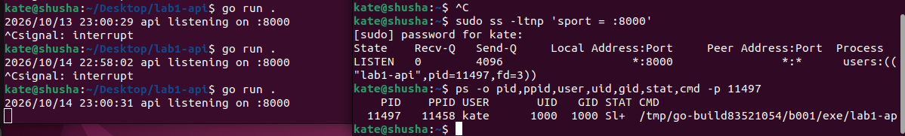

Часть 2 - Namespaces: отдельное представление системы

Помещаем приложение в отдельный namespaces. Сами namespaces не дают процессу дополнительных ресурсов и не ограничивают CPU или память. Их задача создать для процесса собственное представление отдельных частей системы.

Использовались шесть типов namespaces:

| Namespace | Что изолирует | Что проверялось |

| --- | --- | --- |

| pid | Список видимых процессов и их PID | Приложение должно быть PID 1 внутри своего пространства имён и не видеть обычные процессы хоста. |

| user | Отображение UID/GID и область действия привилегий | Внутри можно увидеть uid=0(root), хотя на хосте процесс принадлежит UID 1000. |

| mnt | Таблицу точек монтирования | Можно отдельно настроить /proc и точки монтирования, не меняя mount namespace хоста. В этой работе отдельный root filesystem ещё не создавался. |

| net | Сетевые интерфейсы, маршруты, сокеты и сетевой стек | Внутри оставался только loopback-интерфейс lo; сетевой стек хоста не использовался как собственный. |

| uts | Hostname и NIS domain name | Внутри hostname был изменён на api-ns. |

| ipc | Объекты и механизмы межпроцессного взаимодействия | IPC-объекты нового пространства имён отделены от объектов хоста. |

Запуск производился с помощью утилиты unshare для изоляции указанных namespaces, монтирования /proc под новый PID namespace и настройки hostname с loopback-интерфейсом, после чего текущая оболочка заменялась на процесс API.

После запуска я проверила состояние изнутри:

```bash
hostname
```

```bash
id
```

```bash
ip -brief addr
```

```bash
ps -ef
```

Результат подтвердил hostname api-ns, внутренний uid=0(root) и наличие только lo с адресами 127.0.0.1/8 и ::1/128. В новом PID namespace приложение имело PID 1, а список процессов не показывал обычные процессы хоста.

Затем я проверила тот же процесс снаружи — из хостового окружения:

```bash
grep -E '^(Uid|Gid|NSpid):' /proc/<PID>/status
```

В одном запуске внешний PID был 12352, а строка NSpid выглядела так:

```bash
NSpid:  12352  1
```

Чтобы отдельно проверить сеть приложения, запрос отправлялся из его сетевого namespace:

```bash
sudo nsenter --target "$PID" --net -- curl -i http://127.0.0.1:8000/health
```

Ответ был 200 OK.

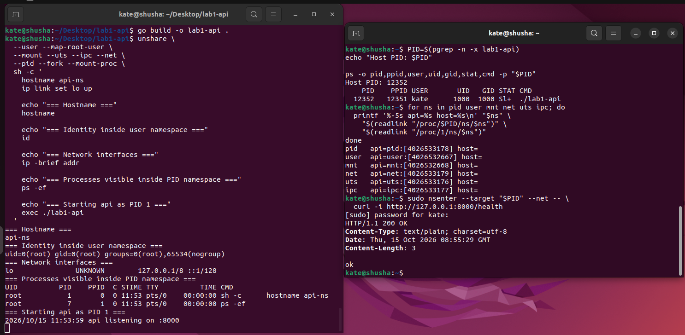

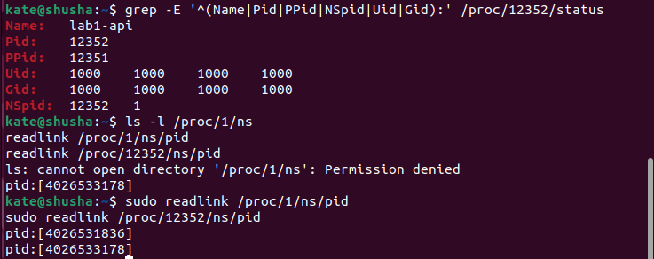

**Вывод** по namespaces: они меняют то, что процесс видит вокруг себя — PID, hostname, сетевые интерфейсы, IPC и точки монтирования. Но они сами по себе не устанавливают потолок памяти или CPU.

Часть 3 - Cgroups v2: ограничения ресурсов

Для отдельного эксперимента была создана группа /sys/fs/cgroup/lab-api-memory, а её лимит памяти установлен в 64 MiB:

```bash
sudo mkdir /sys/fs/cgroup/lab-api-memory
```

```bash
echo 67108864 | sudo tee /sys/fs/cgroup/lab-api-memory/memory.max
```

Затем процесс API был помещён в эту cgroup и проверен endpoint /eat.

Сначала swap был разрешён. Запрос:

```bash
curl -i 'http://localhost:8000/eat?mb=128'
```

вернул сообщение:

```bash
allocated=128 MiB held=128 MiB
```

На первый взгляд могло показаться, что лимит памяти не сработал. Но лимит учитывает давление именно на память, а при доступном swap часть страниц может быть вытеснена из RAM. Это согласовывалось с ненулевыми memory.swap.current и VmSwap процесса. Счётчик max рос, а oom и oom_kill оставались нулевыми.

Чтобы проверить именно OOM в cgroup, swap для тестовой группы запретили, после перезапуска процесса повторили запрос:

```bash
echo 0 | sudo tee /sys/fs/cgroup/lab-api-memory/memory.swap.max
```

```bash
curl -i 'http://localhost:8000/eat?mb=128'
```

```bash
cat /sys/fs/cgroup/lab-api-memory/memory.events
```

На этот раз curl получил Empty reply from server, потому что процесс был завершён во время обработки запроса. В memory.events зафиксировались значения:

```bash
max 116
```

```bash
oom 1
```

oom_kill 1

oom_group_kill 0

Счётчик oom_kill=1 стал главным подтверждением: ядро завершило процесс из-за превышения лимита памяти его cgroup.


Для CPU использовалась отдельная cgroup /sys/fs/cgroup/lab-api-cpu. В файл cpu.max записали:

```bash
echo '50000 100000' | sudo tee /sys/fs/cgroup/lab-api-cpu/cpu.max
```

Первое число — доступная квота CPU в микросекундах, второе — длина периода.

Запрос на /burn. Обработчик бесконечный, поэтому обычного HTTP-ответа он не возвращает; curl завершался по тайм-ауту. Сам по себе тайм-аут ещё не доказывает, что лимит CPU работал: причиной могло быть и просто отсутствие ответа. Поэтому после нагрузки проверяем cpu.stat.

Один из результатов:

```bash
nr_periods      195
```

```bash
nr_throttled    191
```

```bash
throttled_usec  14199036
```

nr_periods считает периоды планирования, а nr_throttled — периоды, в которых cgroup была ограничена по квоте. Здесь throttling произошёл в большинстве периодов, а throttled_usec показал накопленное время ограничения. Так мы подтвердили, что процесс действительно упирался в заданный потолок CPU.


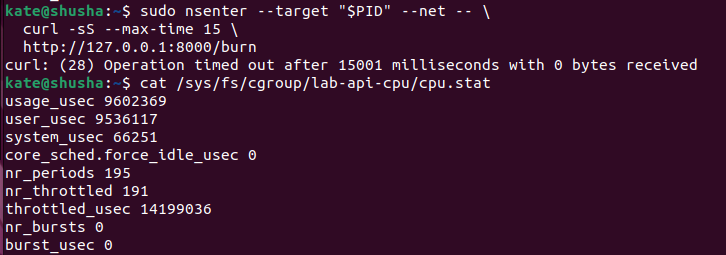

Для проверки pids была создана группа /sys/fs/cgroup/lab-api-pids, а pids.max установлен в 32:

```bash
echo 32 | sudo tee /sys/fs/cgroup/lab-api-pids/pids.max
```

Затем внутри этой группы запускался тест, который активно создаёт процессы:

```bash
stress-ng --fork 64 --timeout 15s --metrics-brief
```

Во время теста pids.current доходил до 32, но число задач выше лимита не поднималось. Счётчик max в pids.events вырос до 87465, а после завершения теста pids.current вернулся к 0.

Этот механизм не обязан убивать уже существующие процессы, он блокирует создание новых задач, когда достигнут лимит. В отдельных случаях вызов создания процесса может завершиться ошибкой. Это защищает хост и соседние workloads от неконтролируемого размножения задач.

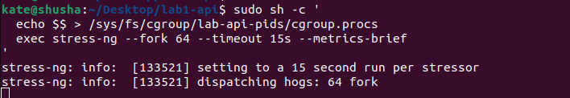

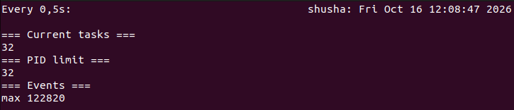

Вывод по cgroups: namespaces изолируют представление системы, а cgroups ограничивают потребление ресурсов.

Часть 4 - Урезание прав: capabilities и seccomp

В Linux полномочия пользователя root разделены на отдельные capabilities. Это позволяет не выдавать процессу весь набор привилегий ради одной операции.

Сначала изменение hostname внутри созданных User и UTS namespaces проходило. Затем была выполнена проверка после исключения CAP_SYS_ADMIN из bounding set через setpriv. Попытка изменить hostname завершилась сообщением:

```bash
hostname: you must be root to change the host name
```

Expected: hostname change denied

Это наглядно показало, что одного UID 0 недостаточно: ядро учитывает также capabilities. В итоговом mydocker.sh наборы capabilities API были очищены. В /proc/<PID>/status на хосте проверялись поля CapInh, CapPrm, CapEff, CapBnd и CapAmb; все они имели нулевые значения. Поле NoNewPrivs было равно 1.

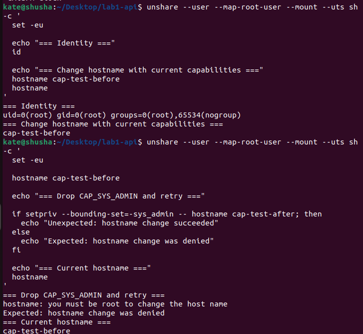

Capabilities ограничивают привилегированные действия, но не определяют весь список системных вызовов, которые процесс может попытаться выполнить. Для этого использовался seccomp — фильтр системных вызовов.

В качестве примера был выбран uname. До установки фильтра команда uname -a работала. Затем с помощью Python создавали правило: для uname возвращать EPERM (Operation not permitted), а остальные вызовы разрешать.

После включения фильтра результат был таким:

uname: cannot get system name: Operation not permitted

```bash
exit=1
```

Фильтр был подключён к mydocker.sh через seccomp_exec.py и файл seccomp-profile.json. Для работающего API проверка /proc/<PID>/status показывала Seccomp: 2 и Seccomp_filters: 1, а /health по-прежнему отвечал 200 OK.


Вывод: capabilities уменьшают объём доступных привилегий, а seccomp ограничивает набор системных вызовов. Это разные уровни защиты, поэтому они дополняют друг друга.

Часть 5 - Собственный launcher mydocker.sh

После того как namespaces, cgroups, capabilities и seccomp были проверены отдельно, команды были объединены в один скрипт — mydocker.sh.

Launcher выполнял следующие шаги:

Проверял, что бинарный файл lab1-api существует.

Включал нужные контроллеры cgroups v2 для дочерних групп.

Создавал cgroup для API и записывал в её файлы ограничения памяти, CPU и числа задач.

Перемещал launcher в нужную cgroup до запуска приложения, чтобы нагрузка API учитывалась в правильной группе.

Создавал namespaces через unshare, настраивал hostname и loopback-интерфейс.

Запускал seccomp-загрузчик и очищал наборы capabilities.

Выполнял API и оставлял возможность удалить созданные ресурсы через cleanup-логику скрипта.

В итоговом launcher применялись такие лимиты:

| Параметр cgroup | Значение | Что это означает |

| --- | --- | --- |

| memory.max | 134217728 | Максимум 128 MiB памяти. |

| memory.swap.max | 0 | Swap для этой группы запрещён. |

| cpu.max | 50000 100000 | Примерно 0,5 логического CPU в среднем. |

| pids.max | 64 | До 64 задач в cgroup |


Затем тот же API был запущен через Docker Engine 29.1.3 с cgroups v2. Для честного сравнения использовались сопоставимые ограничения:

```bash
docker run -d \
```

```bash
--cpus=0.5 \
```

```bash
--memory=128m \
```

```bash
--memory-swap=128m \
```

```bash
--pids-limit=64 \
```

```bash
--cap-drop=ALL \
```

```bash
--security-opt=no-new-privileges \
```

```bash
--security-opt seccomp=./docker-seccomp-profile.json \
```

...

docker inspect подтвердил Memory=134217728, NanoCpus=500000000, PidsLimit=64, CapDrop=["ALL"]. Для процесса контейнера NSpid заканчивался на 1, capability sets были нулевыми, NoNewPrivs=1, Seccomp=2. Endpoint /health возвращал 200 OK. Команда внутри контейнера:

```bash
sudo docker exec api-docker /usr/bin/uname -a
```

завершалась с Operation not permitted, что подтверждало действие пользовательского seccomp-правила.

| Возможность | mydocker.sh | Docker Engine |

| --- | --- | --- |

| Namespaces | Создаются вручную с unshare | Создаются runtime по конфигурации контейнера. |

| Cgroups | Скрипт сам создаёт группы и записывает лимиты | Лимиты задаются параметрами docker run, а применением занимается runtime. |

| Capabilities | setpriv и очистка наборов вручную | Удобные параметры, например --cap-drop=ALL. |

| Seccomp | Python-загрузчик и собственный профиль | Профиль задаётся через --security-opt seccomp=.... |

| Root filesystem | Отдельная файловая система из образа не создаётся | Образ предоставляет слои файловой системы и writable layer контейнера. |

| Сеть | В эксперименте только lo | Можно использовать Docker bridge, внутренние IP и публикацию портов. |

| Жизненный цикл | Небольшая cleanup-логика скрипта | Docker управляет созданием, остановкой, удалением контейнера и связанными ресурсами. |

| Отображение root на хосте | root внутри отображается как UID 1000 пользователя хоста | В использованном rootful Docker процесс на хосте отображался с UID 0. |

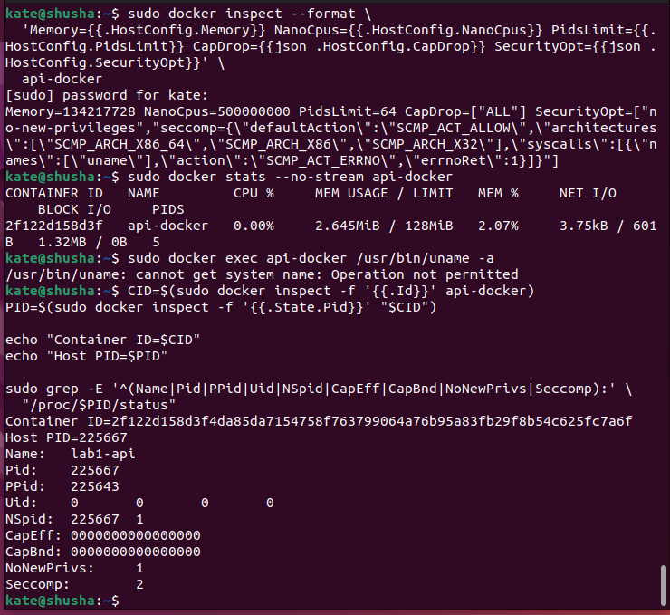

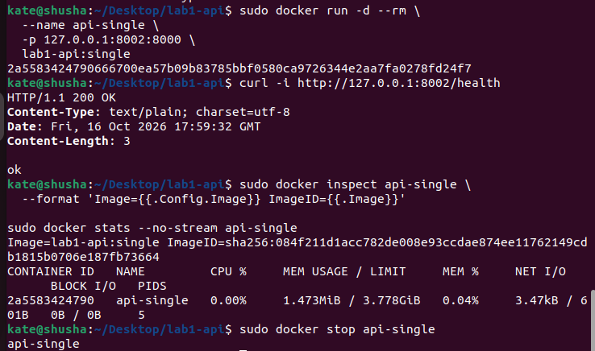

Часть 6 – Образы

Для начала был собран Dockerfile.single на основе golang:1.22:

```bash
sudo docker build -f Dockerfile.single -t lab1-api:single .
```

В этой версии среда Go использовалась и для сборки, и оставалась внутри runtime-образа. По docker image inspect размер составил примерно 304 MiB. Для запущенного API компилятор и инструменты разработки уже не нужны, но они всё равно входят в образ.

Затем была сделана multi-stage-сборка в Dockerfile.multi-stage. В первой стадии builder приложение собиралось с CGO_ENABLED=0, -trimpath и -ldflags="-s -w". Эти параметры позволяют собрать статически связанный бинарный файл без лишних путей сборки и убрать отладочную информацию. В финальной стадии использовался пустой базовый образ scratch; в него копировался только /api, а процесс запускался от пользователя 65532:65532.

```bash
sudo docker build -f Dockerfile.multi-stage -t lab1-api:multi .
```

Результаты сравнения:

| Образ | Размер, байт |

| --- | --- |

| lab1-api:single | 318790322 |

| lab1-api:multi | 2092043 |

Multi-stage-образ оказался примерно в 152 раза меньше. Причина - компилятор и сборочные зависимости остались в промежуточной стадии, а в конечный образ попал только готовый бинарный файл. Пустая база scratch не содержит обычной пользовательской ОС, оболочки и набора утилит.

При повторной сборке без изменений все шаги были взяты из кэша. Если меняется main.go, Docker должен заново выполнить шаги копирования исходников и go build. Более ранние неизменённые шаги, могут остаться в кэше.

Для анализа слоёв использовались история образа и повторная сборка. По сути сравнение такое: single наследует слои большого golang-образа, а финальный scratch содержит только то, что добавлено в минимальную стадию.


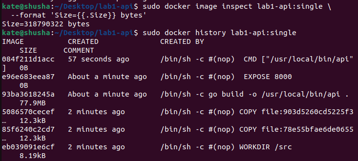

Файловая система образа не изменяется, когда приложение записывает файл внутри запущенного контейнера. Записи по обычным путям попадают в writable layer конкретного контейнера. Если удалить контейнер и создать новый, этот слой будет удалён вместе со старым контейнером — поэтому временный файл пропадает.

Для сохранения данных использовался том api-data-lab, подключённый к каталогу /data. Файл, записанный в /data, оставался доступен после удаления и повторного создания контейнера, потому что том существует отдельно от жизненного цикла контейнера.

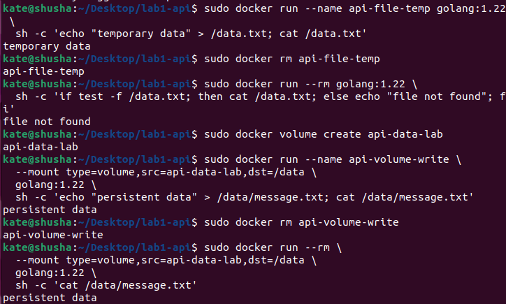

Часть 7 – gVisor

Сначала был установлен и зарегистрирован runsc как Docker runtime. Версия runsc отображалась как release-20261012.0, а docker info показывал зарегистрированный runtime. Затем был успешно запущен hello-world под gVisor, после чего под ним же запускался наш lab1-api.

Использовались следующие параметры:

```bash
sudo docker run -d \
```

```bash
--name api-gvisor \
```

```bash
--runtime=runsc \
```

```bash
-p 127.0.0.1:8005:8000 \
```

```bash
--cpus=0.5 \
```

```bash
--memory=128m \
```

```bash
--memory-swap=128m \
```

```bash
--pids-limit=64 \
```

```bash
--cap-drop=ALL \
```

```bash
--security-opt=no-new-privileges \
```

lab1-api:multi

Чем gVisor отличается по устройству? При обычном runc контейнерный процесс вызывает системные вызовы общего ядра Linux хоста. gVisor добавляет пользовательский слой Sentry, который обрабатывает значительную часть интерфейса Linux, ожидаемого приложением. Благодаря этому приложение меньше взаимодействует напрямую с хостовым ядром, а значит уменьшается поверхность атаки на ядро.

При этом gVisor — не полноценная виртуальная машина и не отдельное ядро Linux. Хостовое ядро остаётся общим, а Sentry сам использует ограниченный набор механизмов хоста. Поэтому gVisor повышает уровень изоляции, но не даёт абсолютной гарантии безопасности.

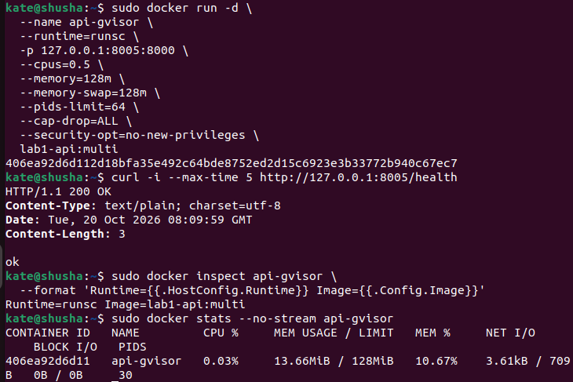

Часть 8 – Мониторинг

Для правил использовались пороговые условия и Pending period = 1m. Это значит, что условие должно сохраняться минуту, прежде чем правило перейдёт в Firing; такой подход помогает не реагировать на кратковременные всплески.

| Правило | Условие | Что ловит |

| --- | --- | --- |

| ContainerMemoryHigh | Память выше 80% лимита в течение 1 минуты | Устойчивый рост рабочего набора памяти |

| ContainerCPUHigh | api-monitor использует больше 0,4 CPU в течение 1 минуты | Длительную нагрузку, близкую к квоте 0,5 CPU |

| ContainerCPUThrottling | Более 50% throttled-периодов в течение 1 минуты | Регулярное достижение лимита CPU |

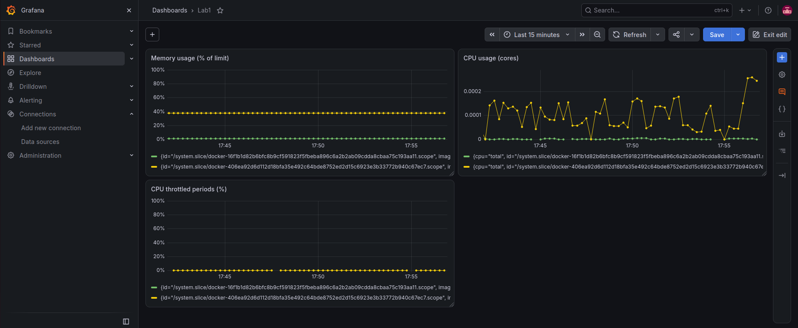

Выводы:

Контейнеры — это просто процессы, зажатые в рамки встроенных механизмов Linux.

У изоляции есть предел. Обычные контейнеры делят общее ядро с хостом. Для безопасности лучше использовать gVisor, который дает прослойку для системных вызовов.

За ресурсами нужен глаз да глаз. Если не ставить лимиты по памяти и CPU, один сервис может убить весь хост.


