# Лабораторная работа — мониторинг сервиса `api`

## Ситуация

Нужно было развернуть в Kubernetes единый стек мониторинга сервиса: метрики, логи, трейсы и алерты. Я использовала Minikube и Helm, чтобы после настройки переиспользовать этот стек в следующих лабораторных. Основная цель — проверить не только установку компонентов, но и прохождение данных по всей цепочке: `api → Prometheus → Grafana`, `api → Alloy → Loki → Grafana`, `api → Jaeger` и `Prometheus → Alertmanager → Karma / внешний webhook`.

## Часть 0 — свой сервис

Сервис реализован на Python с FastAPI. Я использовала несколько endpoint, чтобы воспроизводить типичные ситуации и наблюдать, как на них реагирует мониторинг:

- `GET /health` — проверка доступности;
- `GET /fail` — намеренно возвращает HTTP 500 и увеличивает счётчик ошибок;
- `GET /slow` — задерживает ответ на 1–3 секунды;
- `GET /load` — создаёт дополнительную нагрузку запросами;
- `/metrics/` — отдаёт метрики Prometheus.

Приложение пишет в stdout структурированные JSON-логи с уровнем, сообщением, HTTP-методом, путём, статусом, длительностью и `trace_id`. Для трассировки используется OpenTelemetry. В проекте есть Dockerfile, а образ собирался внутри Minikube, поэтому для запуска сервиса не понадобилось публиковать его во внешнем registry.

```powershell
minikube image build -t api:latest .
minikube image ls | Select-String "api"
helm upgrade --install api .\api\helm\api
kubectl get pods -n default
kubectl get svc -n default
kubectl port-forward svc/api 8000:8000
```

После запуска проверила `/health`, а для тестов мониторинга вызывала `/fail`, `/slow` и `/load`. HTTP 500 от `/fail` — ожидаемое поведение: endpoint нужен, чтобы искусственно создавать ошибки и проверять, можно ли найти их в метриках, логах и трейcах и срабатывают ли алерты.

## Часть 1 — метрики (Prometheus + Grafana)

Для метрик я развернула `kube-prometheus-stack` через Helm в namespace `monitoring` под release `monitoring`. В установленный стек входят Prometheus, Grafana, Prometheus Operator и Alertmanager. Для обнаружения метрик приложения использовала `ServiceMonitor`.

Во время настройки выяснилось, что `/metrics` возвращает редирект HTTP 307, а `/metrics/` отвечает HTTP 200. Поэтому в конфигурации сбора метрик использовала путь со слешем на конце. В Prometheus цель `job="api"` проверяла запросом `up{job="api"}`.

Сначала я собрала базовый RED-дашборд — Request Rate, Error Rate и p95 времени ответа. После этого разделила Request Rate на три временных ряда по endpoint `/fail`, `/load` и `/slow`, чтобы понимать, какой сценарий создаёт запросы. Цвета помогают различать серии без необходимости каждый раз изучать PromQL.

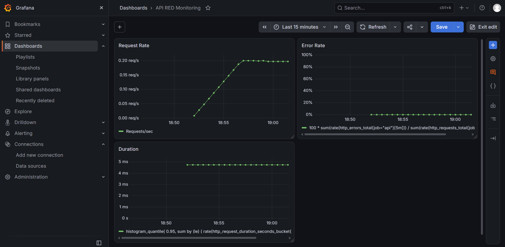

На первом варианте проверила, что Grafana получает метрики и строит графики запросов, ошибок и времени ответа. Этот снимок показывает исходное состояние панели до окончательной настройки серии Request Rate.

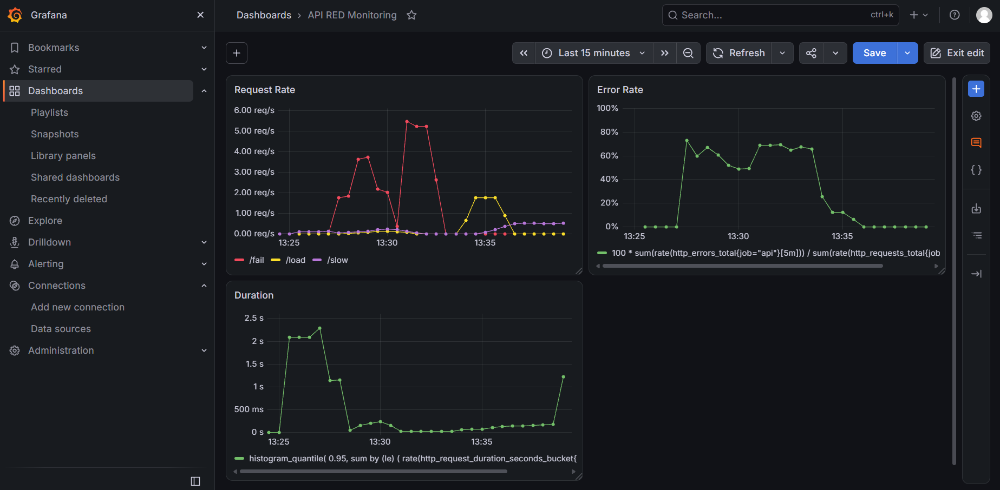

На обновлённой панели Request Rate различаются `/fail`, `/load` и `/slow` — у каждой серии свой цвет. Это нужно, чтобы видеть реакцию на каждый тестовый сценарий отдельно: `/fail` увеличивает количество ошибок, `/load` создаёт всплеск запросов, а `/slow` заметнее отражается на длительности ответа. На графиках видны тестовые пики; Error Rate и Duration помогают связать нагрузку с поведением сервиса.

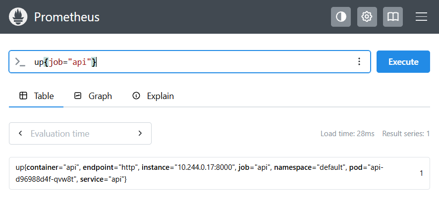

Отдельно проверила цель непосредственно в Prometheus: `up{job="api"}` возвращает `1`. Это подтверждает, что Prometheus обнаружил сервис и успешно опрашивал его на момент проверки. Сам по себе запущенный Pod не доказывает, что метрики уже скрейпятся, поэтому такая проверка нужна отдельно.

## Часть 2 — логи (Loki + Grafana)

Для хранения логов я развернула Loki, а сбор логов Pod'ов поручила Grafana Alloy. Loki не забирает логи из приложения самостоятельно: Alloy читает stdout контейнеров Kubernetes и отправляет записи в Loki. Для Loki включила постоянное хранилище через PVC, чтобы логи не зависели только от жизненного цикла Pod.

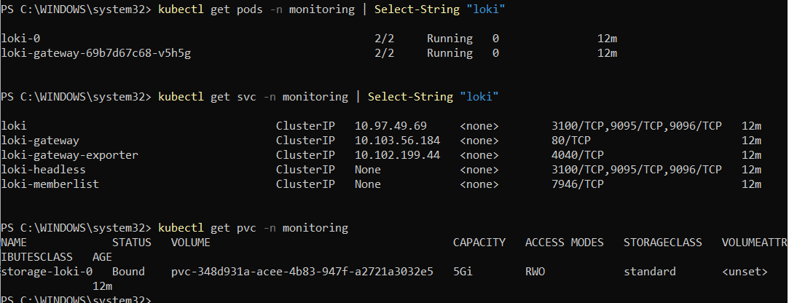

На скриншоте проверены Pod'ы Loki и gateway, Kubernetes-сервисы и PVC. Состояние `Running` показывает, что компоненты запущены, а `Bound` у PVC — что том привязан. При этом запуск Pod ещё не доказывает, что логи приложения доходят до хранилища, поэтому затем отдельно проверила содержимое в Grafana.

В Grafana добавила Loki как источник данных и открыла Explore. Для поиска тестовой ошибки использовала запрос. В результатах ожидается JSON-запись о намеренной ошибке из /fail; она подтвердит, что Alloy считал stdout приложения и передал свежую запись в Loki, а Grafana позволяет эту запись найти.

```logql
{cluster="minikube"} |= "Intentional 5xx error"
```

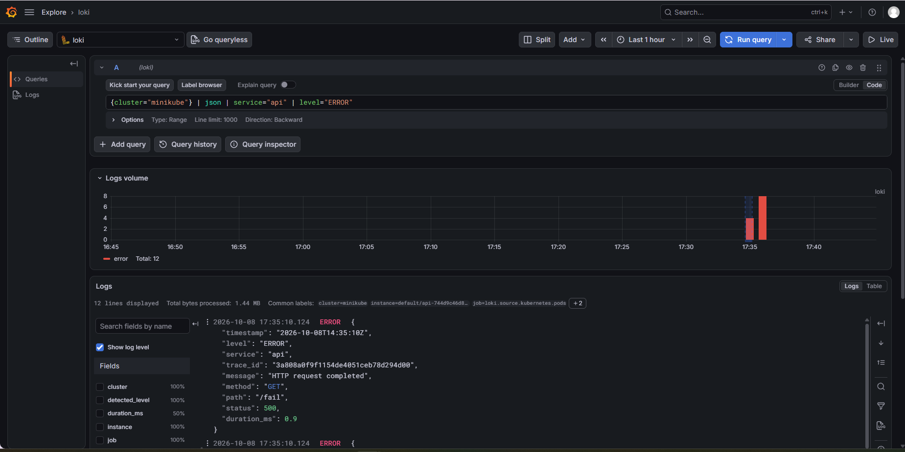

Изначально поиск по `{service_name="api"}` ничего не возвращал: выяснилось, что `service_name` — это метка потока Loki, а `service: "api"` и `trace_id` находятся внутри JSON-содержимого записи. Поэтому я использовала существующую метку `cluster` и фильтрацию по тексту сообщения. Во время настройки Loki также отклонял часть старых записей как `entry too far behind`; проверка свежих записей подтвердила, что новые логи поступают и находятся в Grafana.

## Часть 3 — трейсы (OpenTelemetry + Jaeger)

В API используется OpenTelemetry: библиотека инструментирования создаёт корневой span для входящего HTTP-запроса. В обработчике `/slow` добавлен дочерний span `slow-op`, а для `/fail` span помечается как ошибочный. В JSON-логи добавляется `trace_id`, чтобы по записи лога можно было найти соответствующую трассировку.

Jaeger развернула через Helm в namespace `monitoring`. API находится в namespace `default`, поэтому короткое имя `jaeger:4317` не разрешалось из Pod приложения. Я исправила endpoint экспортёра на полное DNS-имя `jaeger.monitoring.svc.cluster.local:4317`, после чего трассировки появились в Jaeger.

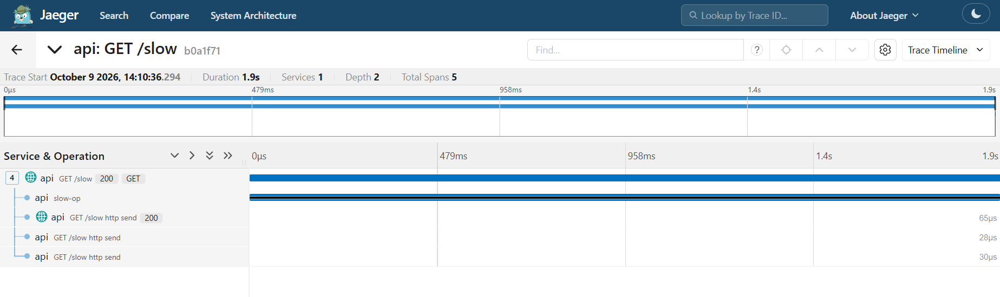

Здесь виден трейс `GET /slow`: общий запрос занимает около 1,9 секунды, в нём есть отдельная операция `slow-op` и дочерние HTTP spans. Такое представление позволяет понять, из каких участков складывается время ответа, а не только увидеть высокую задержку на графике. В отдельном тесте выбранный `slow-op` показывал длительность около 2,6 секунды.

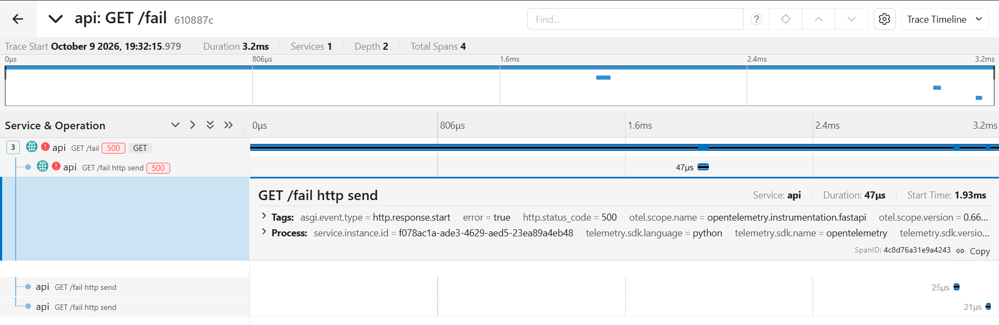

Для `/fail` Jaeger показывает статус HTTP 500 и признаки ошибки (`error=true`, `otel.status_code=ERROR`). Это подтверждает, что ошибка не только возвращается клиенту, но и отражается в трассировке, поэтому её можно отличить от успешного запроса при разборе проблемы.

Чтобы связать лог и трейс, я вызвала `/fail` и просмотрела stdout приложения. Записи `Intentional 5xx error` и `HTTP request completed` для одного запроса имели одинаковый `trace_id`; у записи завершения указан путь `/fail` и статус 500.

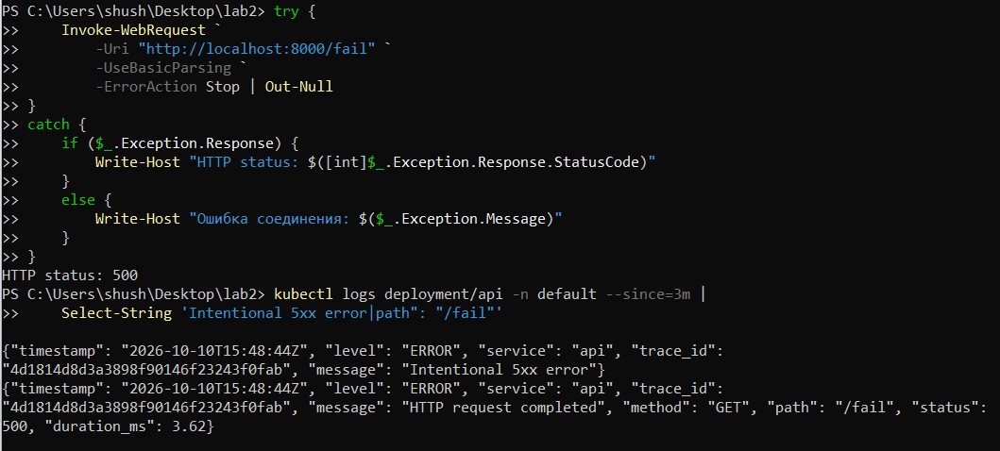

На снимке видно, что две строки относятся к одному запросу: у сообщения об ошибке и у сообщения о завершении совпадает `trace_id`. Это позволяет перейти от описания ошибки в логах к её трассировке.

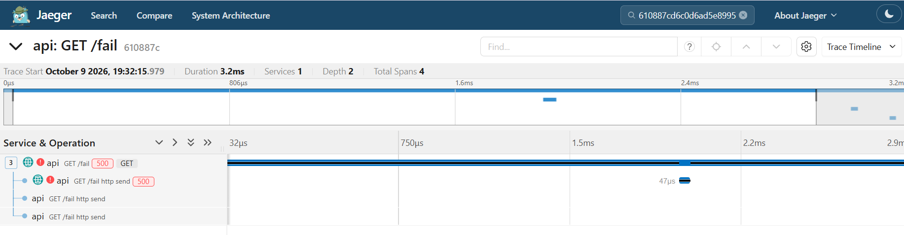

Также проверила ручной поиск в Jaeger: в поле Trace ID вводится сам 32-символьный идентификатор, без LogQL-запроса. По нему можно открыть трейс `/fail` с HTTP 500. Снимки показывают примеры нескольких тестовых вызовов, поэтому идентификаторы на них могут отличаться; для сквозной проверки нужно брать полный ID именно из лога того же запроса. Запрос Loki вида `{cluster="minikube"} |= "Intentional 5xx error"` нельзя вводить в поле Trace ID — это другой язык запросов.

## Часть 4 — алерты (Alertmanager + Karma)

В `monitoring/api-alerts.yaml` я создала `PrometheusRule` с тремя критическими алертами. Перед этим проверила селектор Prometheus Operator: правила должны иметь метку `release: monitoring`, иначе Operator может не передать их в Prometheus. После добавления метки правила появились в группе `api-critical-alerts`.

### APIHighErrorRate

Срабатывает, если доля ошибок превышает 5% в течение одной минуты. Это критично, потому что пользовательские операции могут завершаться HTTP 5xx. Дежурному нужно проверить Error Rate в Grafana, найти ошибочные записи в Loki и, используя `trace_id`, открыть соответствующий trace в Jaeger.

```promql
100 * sum(rate(http_errors_total{job="api"}[5m])) / sum(rate(http_requests_total{job="api"}[5m])) > 5
```

### APIHighLatency

Срабатывает, если p95 времени ответа для `/slow` превышает 2 секунды в течение одной минуты. Даже при HTTP 200 сервис может быть слишком медленным для пользователя, а задержка может привести к таймаутам. Дежурному нужно открыть `/slow` в Jaeger, посмотреть водопад спанов и проверить `slow-op`.

```promql
histogram_quantile(
  0.95,
  sum by (le) (
    rate(http_request_duration_seconds_bucket{job="api", path="/slow"}[5m])
  )
) > 2
```

### APIUnavailable

Срабатывает, если цель `api` исчезла из обнаруженных целей Prometheus или `up` для неё равен 0 в течение одной минуты. Это может означать, что приложение недоступно, либо что нарушен сбор метрик. Дежурному нужно проверить Pod, Kubernetes events, Service/Endpoints, логи контейнера и состояние цели в Prometheus.

```promql
absent(up{job="api"}) or up{job="api"} == 0
```

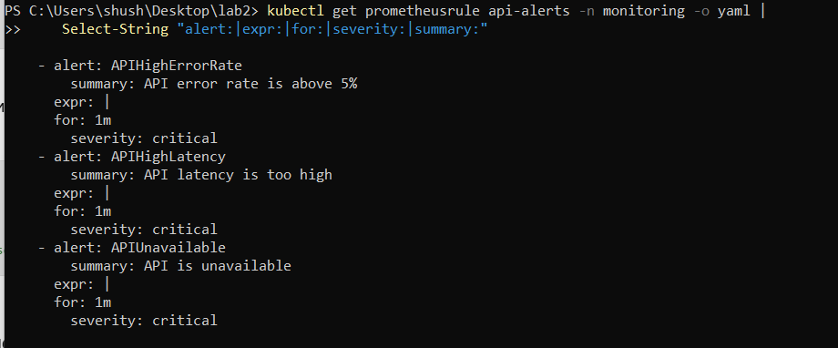

На этом снимке видно, что в манифесте определены все три алерта, каждому задано `for: 1m` и `severity: critical`. Таким образом, правила не реагируют на единичное мгновенное отклонение: условие должно оставаться истинным в течение минуты.

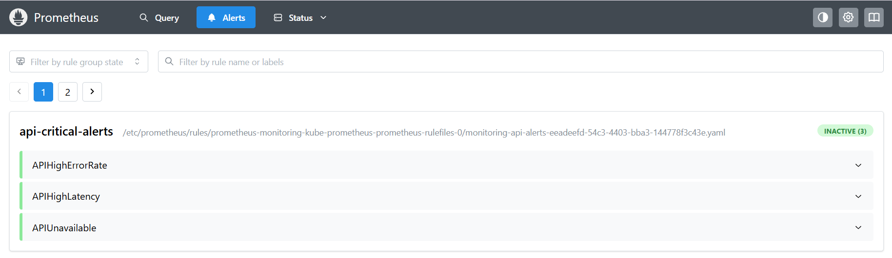

Здесь Prometheus показывает все три пользовательских правила в группе `api-critical-alerts`. На момент этого снимка они были `INACTIVE`, что нормально при отсутствии выполняющегося условия. Это показывает, что Prometheus загрузил правила; чтобы доказать их работу, дополнительно провоцировала ошибки, задержки и недоступность.

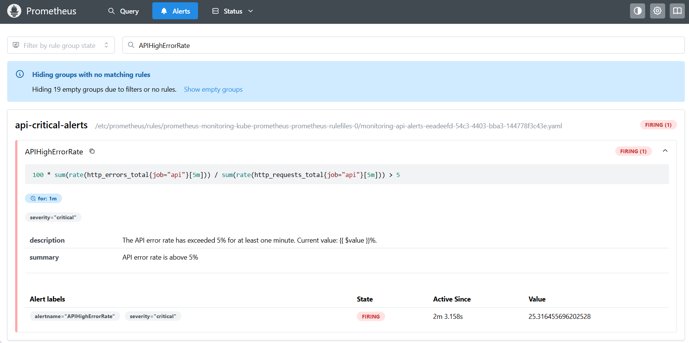

После вызовов `/fail` `APIHighErrorRate` перешёл в состояние `firing`; на этом снимке расчётная доля ошибок составляла около 25,3%, что выше порога 5%. Значение меняется в зависимости от запросов за последнее пятиминутное окно, поэтому при повторном запуске оно может быть другим.

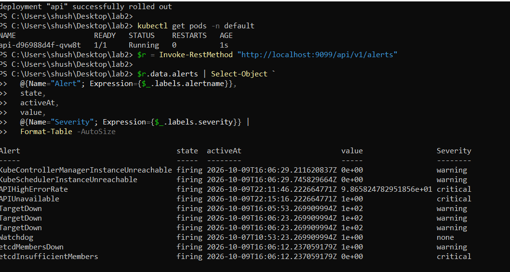

Вывод API Prometheus показывает состояния активных алертов и значения выражений. На снимке `APIHighErrorRate` и `APIUnavailable` находятся в `firing`; у `APIUnavailable` значение `1` указывает на недоступную/неуспешную цель в рамках выражения. Здесь также видны системные алерты Kubernetes — они не относятся к трём пользовательским правилам API. Такие списки важно читать с учётом названия алерта и метки `severity`.

### Alertmanager, внешний получатель и Karma

Alertmanager получил пользовательские алерты и отображал, например, `APIHighErrorRate` с меткой `severity="critical"`. Дополнительно я настроила receiver `api-webhook`, направив уведомления в webhook.site. Внешний получатель принял HTTP POST от `Alertmanager/0.34.1`; в полученном JSON были `receiver: "api-webhook"`, `status: "firing"`, `alertname: "APIHighLatency"`, `severity: "critical"` и описание с текущим p95 около 4,325 секунды. Это подтверждает не только визуализацию алерта, но и отправку уведомления наружу.

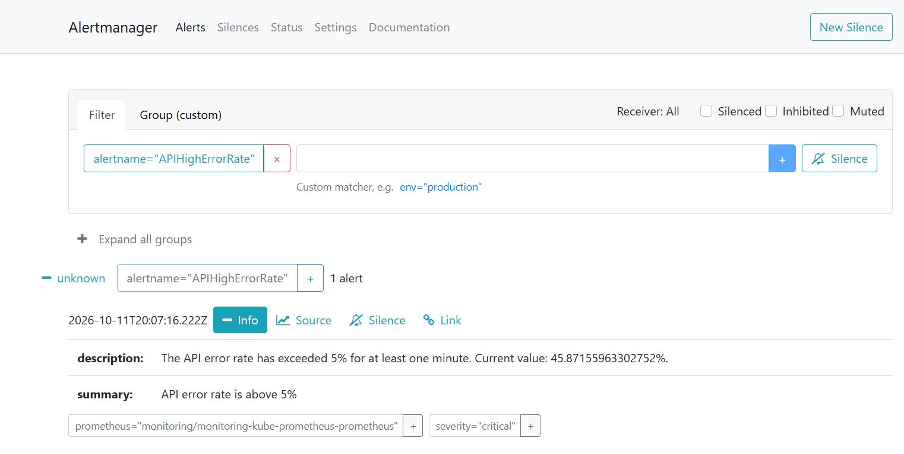

Для проверки внешней доставки настроила получателя через webhook.site. Когда сработал алерт `APIHighLatency`, Alertmanager отправил HTTP POST-запрос на указанный URL. В полученном JSON видны имя алерта, критичность `critical`, состояние `firing` и описание проблемы: p95 времени ответа `/slow` превысил установленный порог 2 секунды. Это подтверждает, что уведомление не только отображается в Alertmanager и Karma, но и успешно доставляется внешнему получателю.

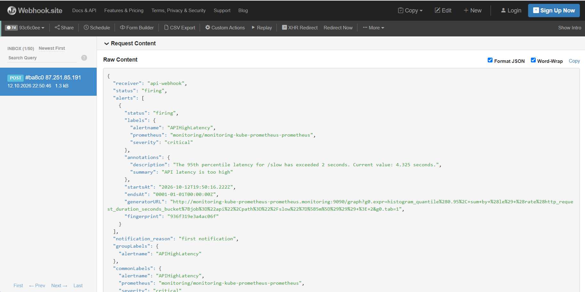

## Результат

В Kubernetes через Helm развернут сервис `api` и стек мониторинга. Prometheus получает метрики через `ServiceMonitor`, Grafana отображает RED-показатели, Alloy собирает stdout Pod'ов и передаёт их в Loki, Jaeger принимает OTLP-трейсы, а Alertmanager получает сработавшие правила. Karma показывает активные алерты, а webhook.site подтвердил получение внешнего уведомления от Alertmanager.

Проверены три сценария: ошибки через `/fail`, задержки через `/slow` и недоступность API через остановку реплик. После проверки недоступности важно вернуть Deployment к одной реплике и убедиться, что Pod готов, `up{job="api"}=1`, а `APIUnavailable` перешёл в resolved/inactive. Этот финальный статус следует проверить непосредственно перед сдачей.

## Выводы

1. Работающий сервис не гарантирует работу мониторинга: из-за ошибок конфигурации метрики, логи или трейсы могут не поступать.
2. У каждого компонента своя роль: Prometheus собирает метрики, Alloy отправляет логи в Loki, Jaeger отображает трейсы, Grafana объединяет метрики и логи, а Alertmanager обрабатывает алерты.
3. Важно проверять реальные данные, а не только статус `Running`: пустой график может быть связан с временным диапазоном, а запущенный агент не гарантирует успешную отправку логов.
4. `trace_id` связывает JSON-лог с трассировкой, что помогает перейти от ошибки к конкретным операциям запроса.
5. Алерты нужно проверять реальными сценариями и проходить всю цепочку до Alertmanager, Karma и внешнего получателя. После теста недоступности нужно убедиться, что сервис восстановился, а алерт разрешился.
