# Лабораторная работа № 4 — «SLA критического пути под перегрузкой»

## Часть 0 — Сервис batch

Для имитации второстепенной нагрузки в Helm-чарт добавлен Deployment фоновой задачи batch (образ shop.local/batch:v1). Потребление памяти регулируется переменной BATCH_MEMORY_MB, также процесс генерирует постоянную нагрузку на CPU.

Чтобы пройти ограждения Kyverno, для batch заданы лимиты и реквесты. Так как задача второстепенная, requests меньше limits (класс QoS — Burstable):

CPU: request 100m, limit 500m

Память: request 128Mi, limit 256Mi

Для пода установлен низкий приоритет и урезанные права в securityContext.

Исходное состояние для тестов: одна готовая реплика batch и BATCH_MEMORY_MB=64.

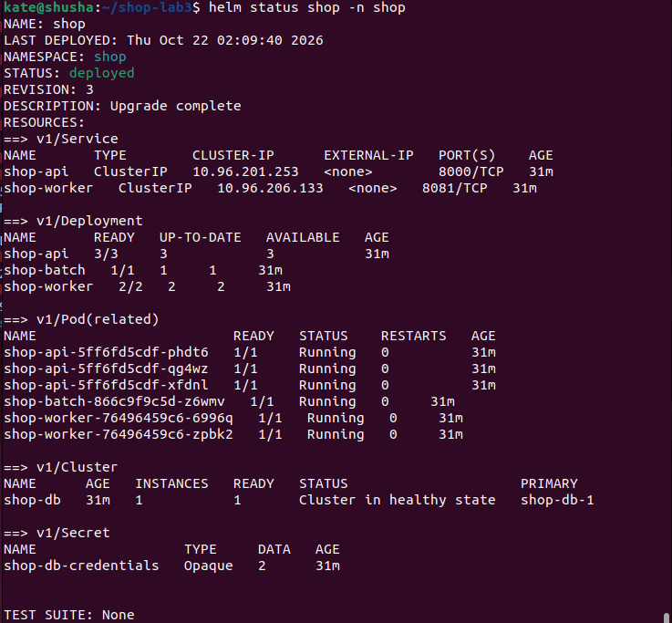
*Рисунок 1 — Helm-релиз shop в состоянии deployed: API 3/3, worker 2/2, batch 1/1 и PostgreSQL в healthy state.*

## Часть 1 — Выбери механизм разнесения

Для распределения реплик API между узлами был выбран механизм topologySpreadConstraints. В values.yaml для API указаны следующие параметры:

```yaml
api:
  replicaCount: 3
  topologySpread:
    maxSkew: 1
    topologyKey: kubernetes.io/hostname
    whenUnsatisfiable: DoNotSchedule
```

- topologyKey: kubernetes.io/hostname — балансировка происходит между разными узлами.
```bash
maxSkew: 1 — Kubernetes не допускает перекоса больше чем на одну реплику между узлами.
whenUnsatisfiable: DoNotSchedule — строгое правило: если размещение нарушит maxSkew, под останется в состоянии Pending.
```

Я отказалась от podAntiAffinity (строгого запрета на совместное размещение), потому что при 3 репликах API и всего 2 узлах кластера одна из реплик неизбежно осталась бы в Pending. Механизм topologySpreadConstraints гибче: он не требует, чтобы все поды стояли отдельно, а лишь балансирует их количество. В моем случае ожидаемое и полученное распределение 3 реплик по 2 узлам составило 2 + 1.

## Часть 2 — Тесная площадка

Для тестов на нехватку ресурсов я создала локальный кластер kind-shop-lab4, состоящий ровно из двух узлов:

shop-lab4-control-plane

shop-lab4-worker

Такая тесная площадка нужна, чтобы суммарные requests запущенных контейнеров быстро превысили свободные ресурсы узлов, заставив планировщик Kubernetes принимать решения о вытеснении (eviction) или приоритизации.

Перед началом тестов я проверила инфраструктуру кластера:

```bash
kubectl --context kind-shop-lab4 get nodes -o wide
kubectl --context kind-shop-lab4 get pods -n shop -o wide
helm status shop -n shop
```

Политики Kyverno из прошлой работы продолжают действовать. Я убедилась, что новый фоновый сервис batch прошел admission-контроль, так как имел прописанные лимиты, метки и не использовал privileged режим. Попытка создать тестовый privileged под была успешно отклонена Kyverno.

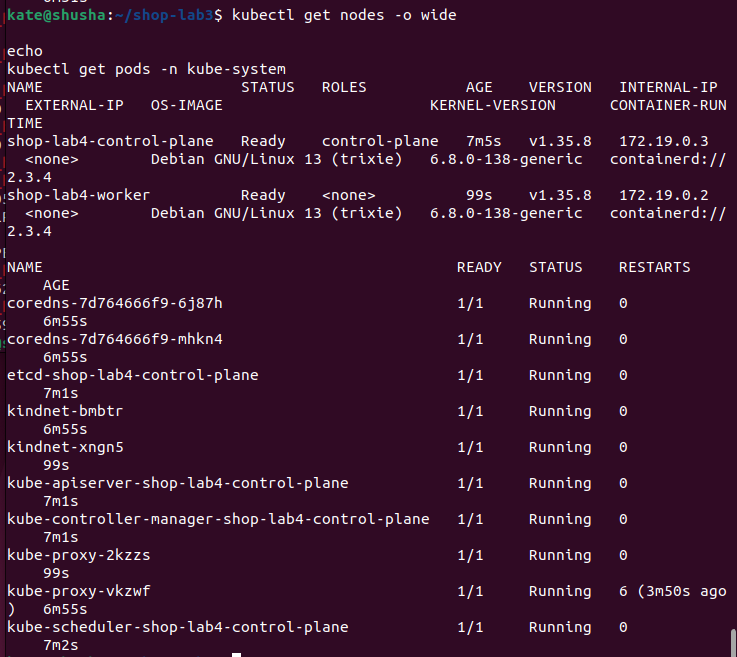
*Рисунок 2 — Два узла kind-кластера shop-lab4 в состоянии Ready и системные Pod на control-plane.*

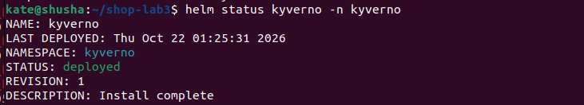
*Рисунок 3 — Helm-релиз Kyverno установлен в namespace kyverno.*

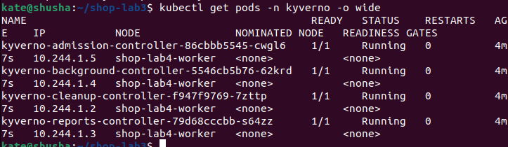
*Рисунок 4 — Pod контроллеров Kyverno запущены и готовы.*

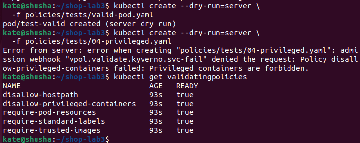
*Рисунок 5 — Список пяти политик Kyverno и отказ admission при попытке создать privileged Pod.*

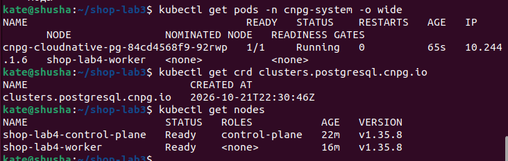
*Рисунок 6 — CloudNativePG установлен, CRD clusters.postgresql.cnpg.io доступен, узлы кластера Ready.*

После подготовки кластера обновили Helm-релиз shop и проверили его состояние. В выводе helm status видны API, worker, batch и объект CloudNativePG Cluster. Это подтвердило, что batch добавлен именно через чарт, а не создан отдельным временным YAML-манифестом.

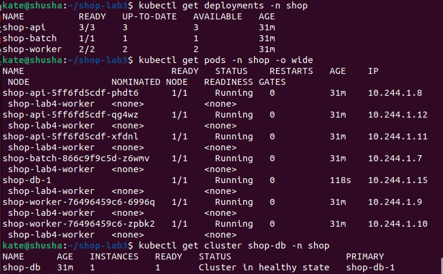
*Рисунок 7 — Deployments, Pod’ы магазина, их IP и узлы размещения, а также состояние CloudNativePG Cluster.*

## Часть 3 — Реальные числа вместо угадывания

Чтобы не определять ресурсы на глаз, использовали KRR (Kubernetes Resource Recommender). Для его работы нужны данные из Prometheus, поэтому сначала убедились, что метрики успешно собираются.

Затем запустили сканирование KRR:

```bash
source .venv-krr/bin/activate
python tools/krr/krr.py simple \
  --context kind-shop-lab4 \
  --namespace shop \
  --prometheus-url http://127.0.0.1:9090 \
  --history_duration 1 \
  --timeframe-duration 1.25 \
  --points-required 5 \
  --formatter json \
  --fileoutput reports/krr-shop-initial.json
```

В отчёте KRR для API был указан ориентир около 10m CPU request и 100Mi памяти. Для worker — также 10m CPU и 100Mi памяти. Для batch KRR около 500m CPU и 100Mi памяти. При этом CPU limit для API не был предложен, а рекомендация по PostgreSQL отсутствовала. В конце вывода присутствовала ошибка HistoryRangeError, поэтому я рассматривала результаты как ориентир, а не как надёжные production-значения.

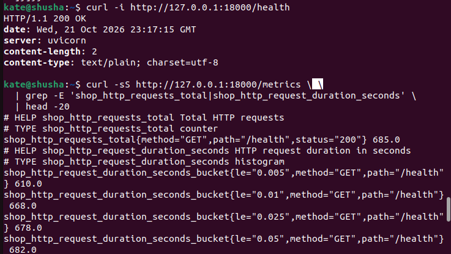
*Рисунок 8 — Проверка /health и выдача метрик приложения через /metrics.*

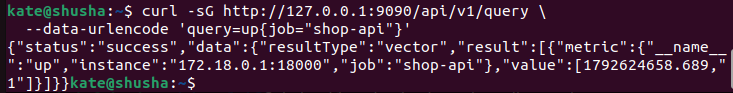
*Рисунок 9 — Prometheus возвращает up для цели shop-api.*

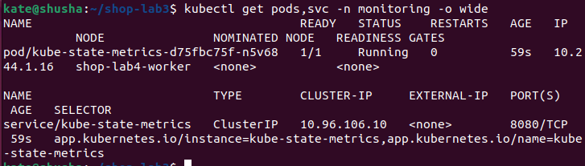
*Рисунок 10 — Pod и Service kube-state-metrics в namespace monitoring.*

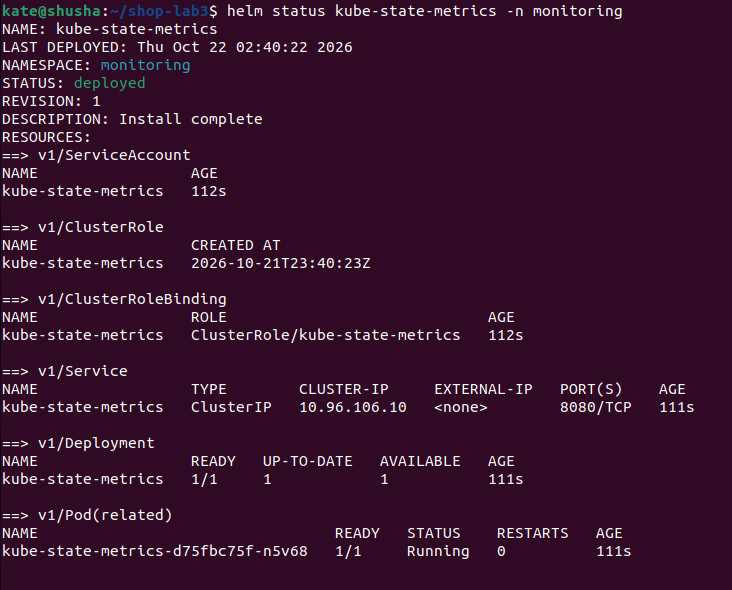
*Рисунок 11 — Helm-релиз kube-state-metrics установлен, Deployment и Pod находятся в рабочем состоянии.*

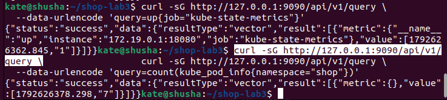
*Рисунок 12 — Проверка kube-state-metrics и количества Pod в namespace shop через Prometheus API.*

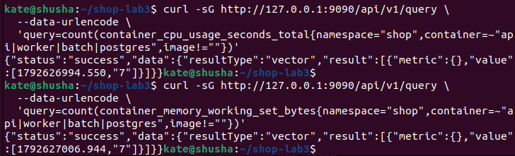
*Рисунок 13 — Запросы Prometheus к CPU и working set памяти контейнеров магазина.*

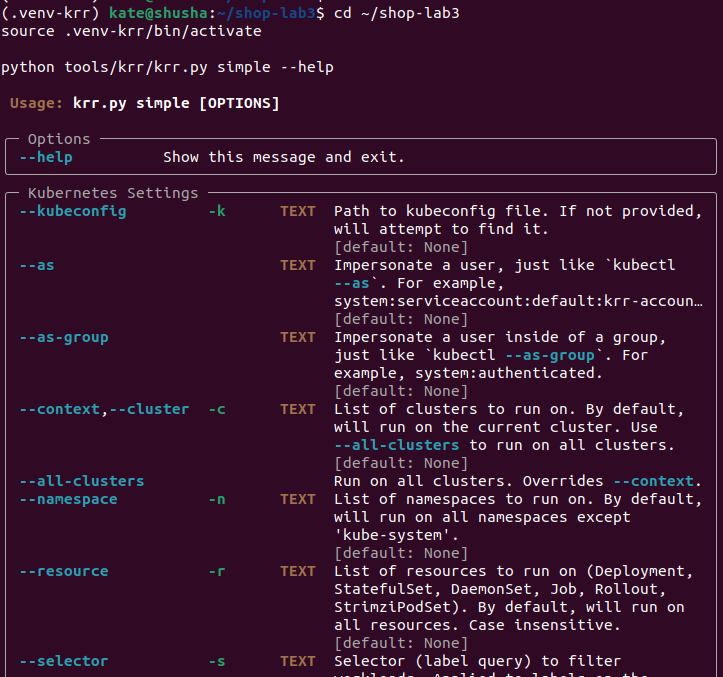
*Рисунок 14 — Параметры командной строки KRR перед запуском.*

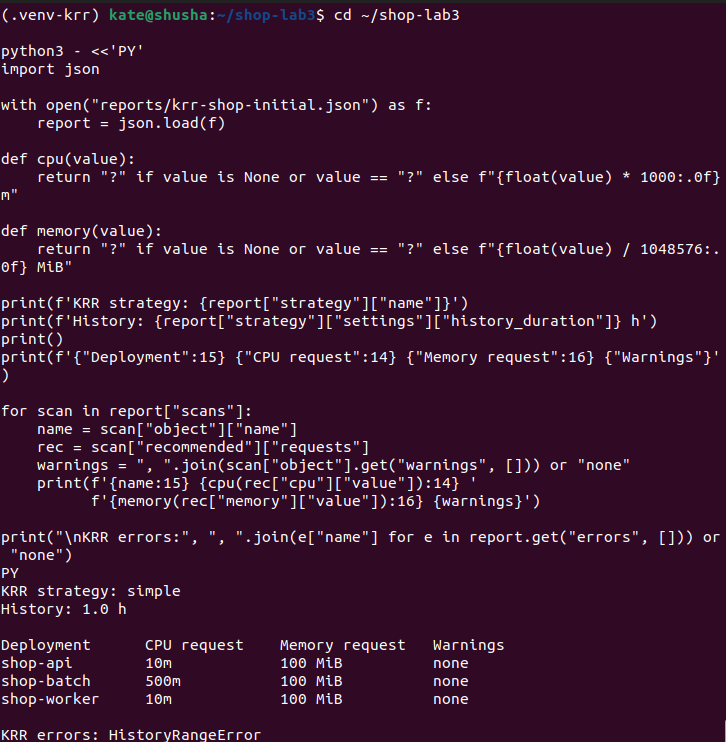
*Рисунок 15 — Вывод KRR: рекомендации для API, batch и worker, а также HistoryRangeError.*

Для PostgreSQL надёжной рекомендации в сохранённом JSON не было. Отдельный замер показывал примерно 20m CPU и 48.37MiB памяти. Поэтому для базы оставлены консервативные значения вручную — 1 CPU и 1Gi памяти. Это не результат KRR, и я отдельно учитываю это ограничение при сравнении.

### Итоговые значения values.yaml

Итоговые значения, внесённые в `values.yaml`, получились такими:

| Компонент | Request CPU / RAM | Limit CPU / RAM | Пояснение |
| :--- | :--- | :--- | :--- |
| API | 500m / 256Mi | 500m / 256Mi | Выше короткой рекомендации KRR; requests равны limits для QoS Guaranteed |
| PostgreSQL | 1 CPU / 1Gi | 1 CPU / 1Gi | KRR не дал пригодной рекомендации; выбрано вручную с запасом |
| Worker | 10m / 100Mi | 500m / 128Mi | Requests совпадают с ориентиром KRR |
| Batch | 100m / 128Mi | 500m / 256Mi | Фоновая нагрузка; requests ниже limits, класс Burstable |

Сравнение с первоначальной догадкой показало, что API сначала имел requests 100m / 128Mi, а после настройки — 500m / 256Mi. Worker изменился с 100m / 64Mi до 10m / 100Mi, то есть его requests стали ближе к рекомендации KRR. Для batch исходные requests 100m / 128Mi оставили без изменений, хотя KRR предлагал 500m CPU / 100Mi памяти: высокий CPU request для фоновой задачи зарезервировал бы слишком много ресурса, который нужен критическому пути. Для PostgreSQL исходные requests 250m / 512Mi заменили на 1 CPU / 1Gi, потому что KRR не дал пригодной рекомендации и требовался QoS Guaranteed.

| Компонент | Исходные requests | KRR: ориентир requests | Итоговые requests |
| :--- | :--- | :--- | :--- |
| API | 100m / 128Mi | 10m / 100Mi | 500m / 256Mi |
| Worker | 100m / 64Mi | 10m / 100Mi | 10m / 100Mi |
| Batch | 100m / 128Mi | 500m / 100Mi | 100m / 128Mi |
| PostgreSQL | 250m / 512Mi | Нет пригодной рекомендации | 1 CPU / 1Gi |

## Часть 4 — Разнеси критический сервис

После применения настроек topologySpreadConstraints (из Части 1) я проверила фактическое размещение реплик API командой:

```bash
kubectl get pods -n shop -o wide
```

Результат подтвердил ожидаемую топологию: из трёх реплик API одна разместилась на узле shop-lab4-worker, а две другие — на shop-lab4-control-plane (схема 2 + 1).

Такое разнесение гарантирует отказоустойчивость: при падении любого из узлов кластера у нас останется хотя бы одна рабочая реплика API, способная обрабатывать запросы пользователей.

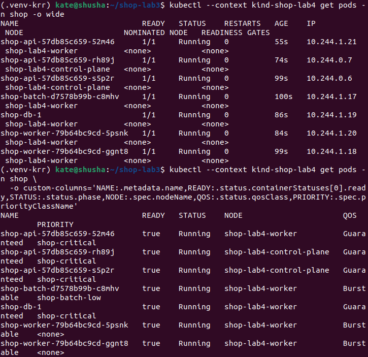
*Рисунок 16 — Размещение трёх API Pod на двух узлах, PriorityClass и классы QoS для компонентов магазина.*

## Часть 5 — Приоритеты и гарантии

Для управления ресурсами в условиях перегрузки были настроены классы приоритетов (PriorityClass):

Для критических API и PostgreSQL назначен высокий приоритет: shop-critical (значение 100000).

Для фонового batch — низкий приоритет: shop-batch-low (значение -10, preemptionPolicy: Never).

Приоритеты работают в связке с классами обслуживания. API и PostgreSQL получили QoS Guaranteed, что делает их максимально защищенными от вытеснения. Задача batch получила класс Burstable (requests ниже limits), поэтому при нехватке памяти на узле Kubernetes вытеснит именно её.

Для дополнительной защиты API был настроен PodDisruptionBudget (PDB) shop-api-pdb с условием minAvailable: 2. Это запрещает кластеру при добровольных операциях обслуживания убивать поды API так, чтобы их осталось меньше двух.

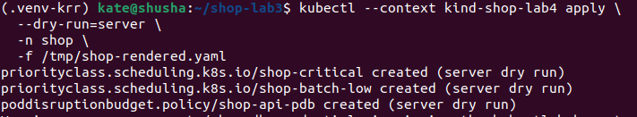
*Рисунок 17 — Server-side dry-run Helm-манифестов: создаются PriorityClass и PodDisruptionBudget.*

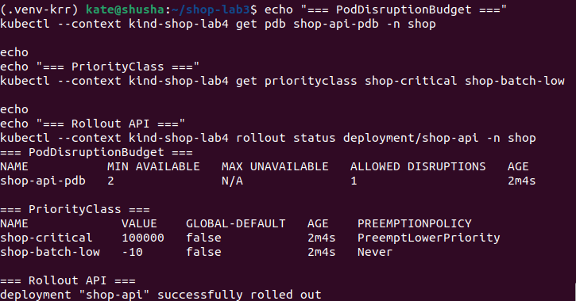
*Рисунок 18 — Значения PriorityClass и PDB shop-api-pdb: minAvailable=2, ALLOWED DISRUPTIONS=1.*

## Часть 6 — Создай нехватку, поймай preemption

Для наглядной проверки механизма вытеснения сначала увеличили количество реплик batch с 1 до 2 через values.yaml и выполнили helm upgrade. Однако ресурсов узлов все еще хватало на всё.

Чтобы гарантированно спровоцировать перегрузку по CPU, был запущен временный тестовый под shop-preemption-helm-test.

Его настройки:

Приоритет: shop-critical (100000).

NodeSelector: принудительно направлен на shop-lab4-worker.

Ресурсы: CPU request/limit 1600m.

Сначала планировщик выдал ошибку FailedScheduling — на воркере не хватало места. Затем планировщик заметил, что узел занят низкоприоритетными подами batch, и инициировал их вытеснение. Поды batch были убиты и перешли в статус Pending, освободив место. После этого тестовый высокоприоритетный под успешно занял узел и перешел в Running.

После успешной фиксации событий тестовый под был удалён, а количество реплик batch возвращено к 1 через Helm.

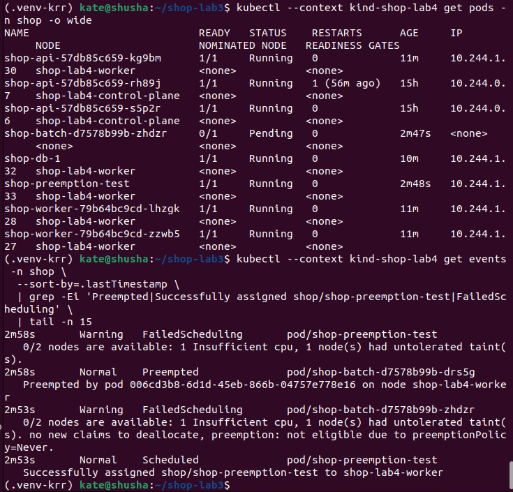
*Рисунок 19 — Состояние Pending, событие FailedScheduling из-за Insufficient cpu, два события Preempted для batch и успешное назначение тестового Pod.*

## Часть 7 — Давление по памяти, порядок жертв

В этой части протестировали разницу между превышением собственных лимитов и нехваткой ресурсов на узле.

Проверка OOMKilled (ограничение контейнера)

Я временно установила BATCH_MEMORY_MB=320 для batch, при том, что его memory limit был равен 256Mi. Контейнер попытался забрать памяти больше, чем ему разрешено его собственным лимитом. В результате ядро Linux сразу же его убило.

В логах зафиксировался reason=OOMKilled и код выхода 137. API и остальные поды не пострадали.

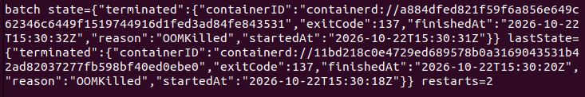
*Рисунок 20 — Состояние контейнера batch с reason=OOMKilled, exitCode=137 и двумя перезапусками.*

Проверка Evicted

Затем я сымитировала нехватку памяти на самом узле (ужесточив настройки soft eviction threshold у kubelet). В этом случае batch не выходил за свои лимиты, но памяти не хватало самому железу.

Так как batch имел низкий приоритет и QoS Burstable, kubelet принудительно вытеснил его. Критичные поды продолжили работу.

Итак, три диагноза различаются следующим образом:

| Состояние | Что произошло | Кто принимает решение |
| :--- | :--- | :--- |
| OOMKilled | Контейнер превысил собственный memory limit | Механизм OOM ядра/cgroup |
| Evicted | На узле не хватило доступной памяти, kubelet удалил Pod | Kubelet по node-pressure threshold |
| Preempted | Планировщик освободил ресурсы для Pod с более высоким приоритетом | Scheduler по PriorityClass |

## Часть 8 — Докажи SLA под нагрузкой

Чтобы проверить, что фоновой нагрузке действительно можно уступить ресурсы, а критический путь оформления заказа остаётся быстрым, я использовала k6. Сценарий load/order-load.js постепенно увеличивал нагрузку: 1, затем 3 и до 5 виртуальных пользователей. Запросы шли по пути заказа, а не просто на health endpoint.

Для лабораторной задала два порога SLA: 95-й перцентиль времени ответа должен быть меньше 300 мс, а доля неуспешных HTTP-запросов — меньше 1%. Такой набор проверяет и скорость, и успешность операции. Среднее время здесь не подходит как единственная метрика: даже при хорошем среднем значении часть пользователей может получать очень медленные ответы, поэтому важен p95.

http_req_failed: rate < 0.01
http_req_duration: p(95) < 300 ms

Сначала был выполнен baseline-прогон, до окончательной настройки ресурсов и размещения. Он обработал 1 533 проверки со скоростью 8.52 req/s. Ошибок не было, но p95 составил 585.52 мс, поэтому порог 300 мс не прошёл. Максимальная задержка достигла 924.87 мс.

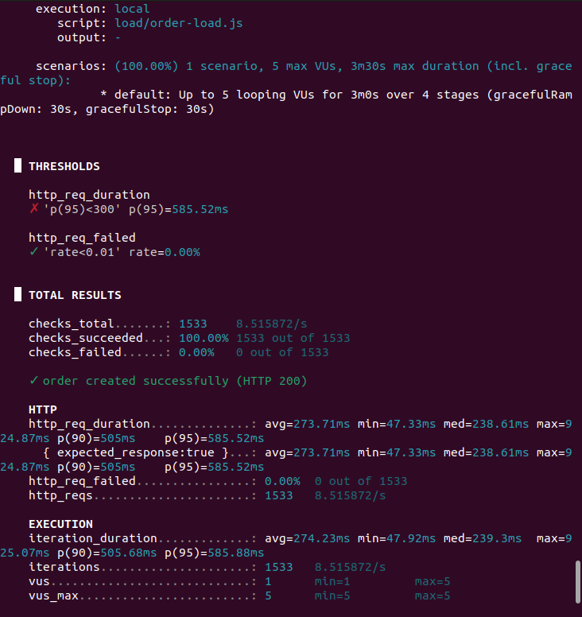
*Рисунок 21 — Baseline k6: 1 533 проверки, 0% ошибок, но p95=585.52 мс — порог SLA не пройден.*

После настройки scheduling и ресурсов повторный прогон обработал 5 370 проверок со скоростью 29.83 req/s. Средняя задержка снизилась до 77.89 мс, медиана составила 70.74 мс, p95 — 150.67 мс, а HTTP-ошибок снова было 0%. В этом тесте оба порога были пройдены.

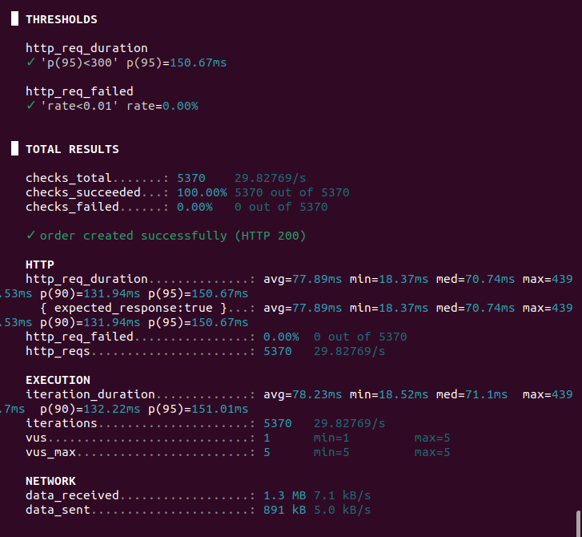
*Рисунок 22 — k6 после настройки: 5 370 проверок, 29.83 req/s, p95=150.67 мс и 0% ошибок.*

Дополнительно был выполнен прогон с фоновой нагрузкой batch при двух репликах. В успешном повторе, сохранённом как reports/k6-under-load-retry.json, получилось 4 966 запросов, 27.58 req/s, средняя задержка 84.32 мс, медиана 76.17 мс, p95 165.02 мс, максимум 314.82 мс и 0 ошибок. Оба заданных порога — p95 ниже 300 мс и ошибки ниже 1% — были пройдены.

| Метрика | Baseline | После scheduling | Под фоновой нагрузкой batch |
| :--- | :--- | :--- | :--- |
| Запросы / проверки | 1 533 | 5 370 | 4 966 |
| Пропускная способность | 8.52 req/s | 29.83 req/s | 27.58 req/s |
| Средняя задержка | 273.71 ms | 77.89 ms | 84.32 ms |
| Медианная задержка | 238.61 ms | 70.74 ms | 76.17 ms |
| p95 | 585.52 ms | 150.67 ms | 165.02 ms |
| Максимальная задержка | 924.87 ms | 439.53 ms | 314.82 ms |
| HTTP-ошибки | 0% | 0% | 0% |
| SLA: p95 < 300 ms | Не пройден | Пройден | Пройден |
| SLA: ошибки < 1% | Пройден | Пройден | Пройден |

## Часть 9 — Мониторинг

Для мониторинга я использовала существующий Prometheus Operator из предыдущей работы (в namespace monitoring). Чтобы подключить к нему наш магазин, в values.yaml чарта shop были включены объекты ServiceMonitor и PrometheusRule. Обязательным условием для автообнаружения было наличие у них метки prometheus: shop.

Проверка через API Prometheus подтвердила, что он нашел 3 таргета API (по одному на каждую реплику) и все они в состоянии UP.

В чарт были добавлены три алерта:

- ShopAPIDown: цель недоступна 15 секунд.
- ShopAPI5xxErrors: появились HTTP 5xx ошибки.
- ShopAPIHighLatency: p95 задержки > 0.5 сек.
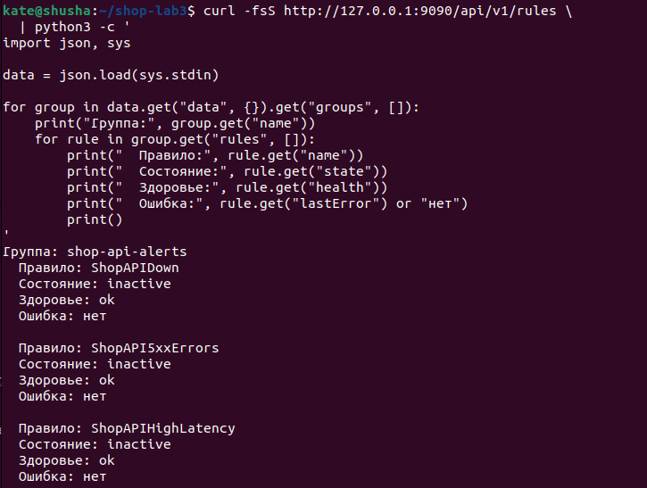
*Рисунок 23 — Три правила группы shop-api-alerts: ShopAPIDown, ShopAPI5xxErrors и ShopAPIHighLatency; в момент снимка они inactive.*

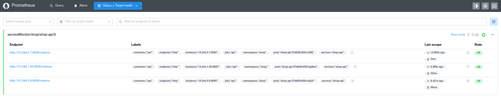
*Рисунок 24 — В Prometheus Operator видны три target’а ServiceMonitor/shop-api, каждый находится в состоянии UP.*

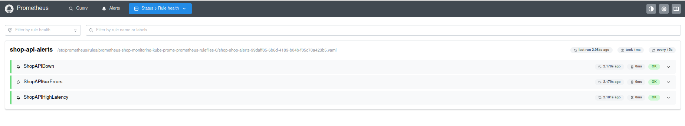
*Рисунок 25 — Страница Rules показывает группу shop-api-alerts и все три загруженных правила.*

Чтобы проверить алерт на ошибки, я намеренно сломала подключение API к базе. При этом /health продолжал отвечать штатно (200), а вот попытка создать заказ (POST /order) стала возвращать ошибку 503 Database unavailable.

Prometheus успешно это зафиксировал, и алерт ShopAPI5xxErrors перешел в состояние Firing.

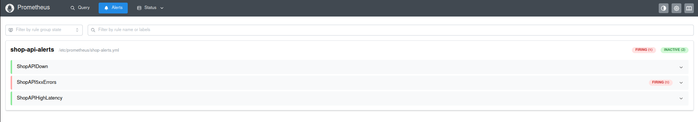
*Рисунок 26 — ShopAPI5xxErrors в Prometheus Operator перешёл в состояние Firing после получения HTTP 503 от POST /order.*

После теста конфигурация БД была восстановлена, Deployment перезапущен, ошибки прекратились, и алерт вернулся в состояние inactive.

Дашборд Grafana выводит классические RED метрики: RPS, HTTP 5xx Error Rate и Response Time p95. На графике RPS зафиксирован исторический провал — это следствие временного обрыва port-forward во время обновления Deployment.

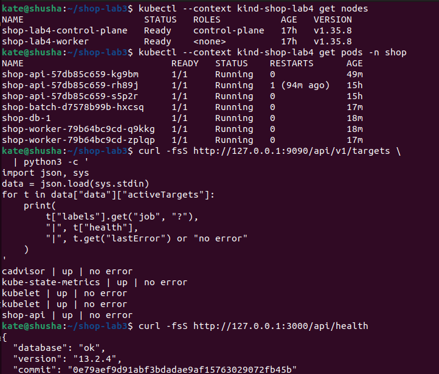
*Рисунок 27 — Финальная проверка: оба узла Ready, API 3/3, batch 1/1, PostgreSQL Running, targets Prometheus UP и Grafana database: ok.*

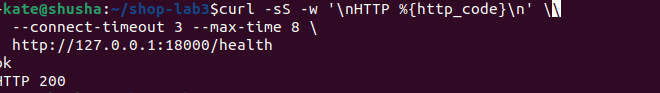
*Рисунок 28 — Контрольный запрос /health после восстановления конфигурации вернул HTTP 200.*

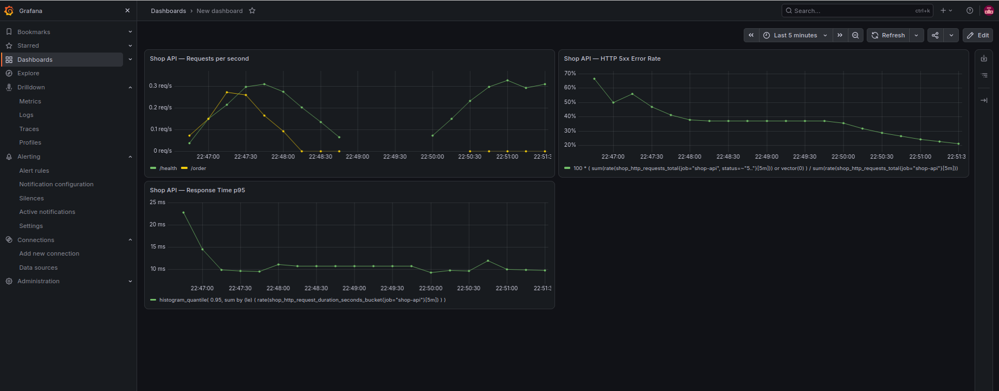
*Рисунок 29 — Дашборд Grafana Shop API: Requests per second, HTTP 5xx Error Rate и Response Time p95.*
