# Лабораторная работа № 5 — «Zero-trust сеть с доказательством»

## Часть 0 — Выбери CNI

Сетевые политики (NetworkPolicy) не реализуются ядром Kubernetes самостоятельно: их исполнение целиком возлагается на CNI-плагин (Container Network Interface). Стандартный CNI-плагин kindnet, используемый в Kind по умолчанию, игнорирует сетевые политики: манифест NetworkPolicy успешно принимается API-сервером, однако фактическая фильтрация пакетов не осуществляется. Для создания полноценной Zero Trust среды требовался специализированный CNI.

При выборе CNI рассматривались два основных решения:

- Calico
- Cilium
Обоснование выбора: для лабораторной работы выбран Cilium 1.20.3. Решающим фактором стала подсистема Hubble, предоставляющая строгую доказательную базу работы политик Zero Trust (фиксация дропов) и удобную визуализацию карты связности.

## Часть 1 — Разверни shop и исследуй сеть пода

Для проведения исследований был развернут двухузловой кластер Kind без стандартного плагина kindnet. В кластер установлен CNI Cilium 1.20.3 с включенными модулями Hubble Relay и веб-интерфейсом Hubble UI. В выделенном namespace shop развернут Helm-чарт приложения shop, включающий API (3 реплики), Worker (2 реплики), PostgreSQL (оператор CloudNativePG) и тестовый генератор нагрузки chaos-client.

После запуска проверено состояние узлов кластера и системных подов Cilium/Hubble в namespace kube-system. Оба узла находились в состоянии Ready, а сетевые демоны Cilium и Hubble успешно функционировали:

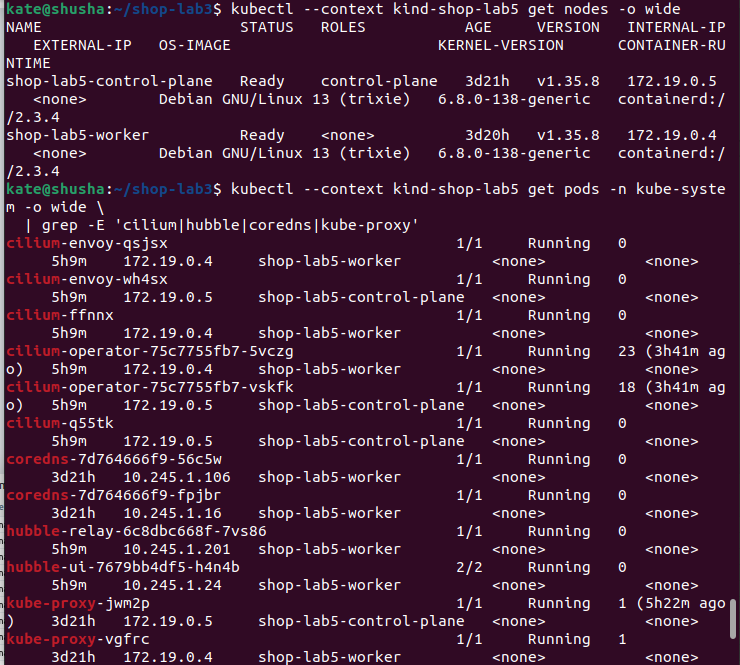

Исследование сети пода: в плоской сети каждому поду выделяется собственный IP-адрес из диапазона PodCIDR. Внутри сетевого пространства имен пода сетевой интерфейс eth0 имеет собственный IP и индекс iflink. На стороне хостового узла этот интерфейс соединен с виртуальным сетевым интерфейсом veth. BPF-программы перехватывают трафик на уровне интерфейса и направляют его напрямую адресату. Поды, размещенные на разных узлах, связываются напрямую по IP-адресам без дополнительного NAT:

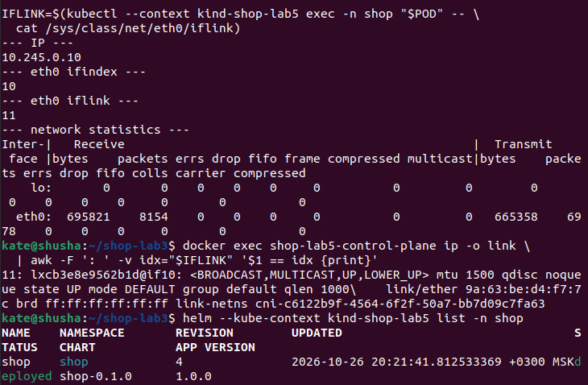

Статус развертывания приложения shop: все компоненты успешно запустились, база данных shop-db перешла в состояние healthy, а сервис API стал доступен для проверки:

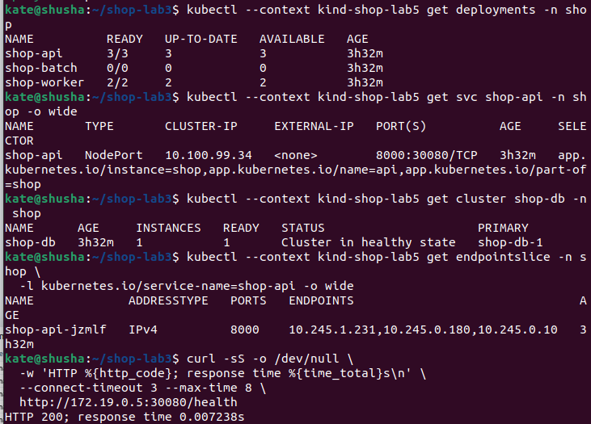

## Часть 2 — Докажи непрерывность через хаос подов

Для организации клиентского доступа сервис shop-api был опубликован наружу кластера через Kubernetes Service типа NodePort.

Сравнение механизмов публикации сервисов в Kubernetes:

- NodePort — резервирует порт (30000–32767) на всех узлах. Подходит для локальных стендов и прямого доступа.
LoadBalancer — облачный балансировщик с публичным IP (расширяет NodePort).

Headless (ClusterIP: None) — сервис без виртуального IP; DNS возвращает прямые IP подов. Нужен для баз данных (StatefulSet) или клиентской балансировки.

Эксперимент с непрерывным хаосом подов: был запущен фоновый скрипт хаос-тестирования, который каждые несколько секунд принудительно удалял случайный рабочий под shop-api или shop-worker (всего произведено 6 удалений: 3 API, 3 Worker). Параллельно утилита shop-chaos-client генерировала непрерывный поток клиентских HTTP-запросов к сервису shop-api по его доменному имени http://shop-api.shop.svc.cluster.local:8000/health (через CoreDNS, а не по прямому IP пода):

| Показатель стресс-тестирования | Полученное значение | Статус / Оценка |
| :--- | :--- | :--- |
| Всего сгенерировано запросов | 140 | Завершено в полном объеме |
| Успешных запросов (HTTP 200) | 140 (100.0%) | 100% доступность сервиса (0 ошибок) |
| Ошибок и отказов (5xx / Timeout) | 0 (0.0%) | Потери пакетов и сбои отсутствуют |
| Среднее время ответа | 44.24 мс | Высокая производительность |
| Медианная задержка (p50) | 32.01 мс | Штатный базовый отклик |
| 95-й перцентиль задержки (p95) | 93.91 мс | Стабильное удержание SLA |
| Максимальная задержка | 380.17 мс | Кратковременный всплеск при ротации пода |
| Количество удалений подов | 6 (3 api, 3 worker) | Успешное самовосстановление |

График непрерывности показал, что ни один запрос клиента не провалился, пока под капотом поды непрерывно умирали и пересоздавались с новыми IP-адресами:

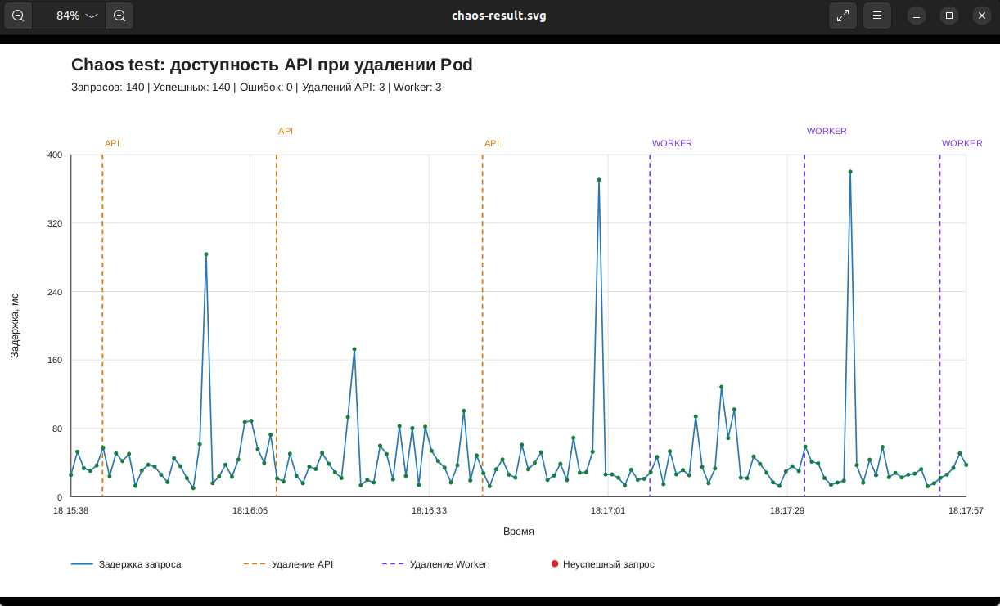

Итоговый отчет терминала подтверждает нулевой процент ошибок (140 из 140 успешных запросов):

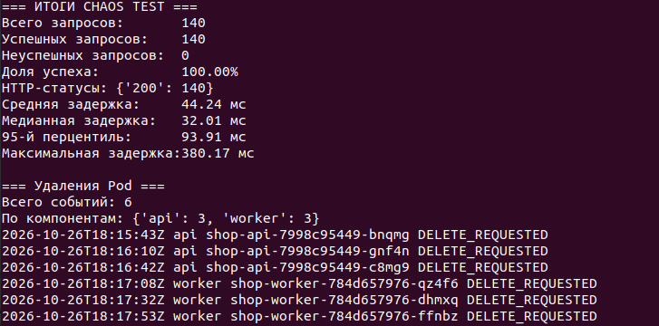

Почему это сработало:

- CoreDNS — клиент обращается к неизменному имени сервиса, которое разрешается в стабильный виртуальный ClusterIP (10.100.99.34). Клиенту не требуется знать реальные динамические IP-адреса подов.
- EndpointSlice — контроллер Kubernetes отслеживает состояние подов. Как только под получает сигнал SIGTERM, он немедленно исключается из EndpointSlice до физической остановки контейнера.
- Cilium eBPF Datapath — BPF-программы на сокетах мгновенно обновляют таблицы трансляции адресов BPF maps при изменении EndpointSlice. Новые TCP SYN-пакеты направляются исключительно на оставшиеся в живых поды без потери соединений.
- Режимы kube-proxy (iptables vs IPVS): в классическом стеке iptables создает цепочки KUBE-SERVICES и KUBE-SVC-*. При проверке каждого пакета ядро последовательно перебирает правила со сложностью O(N). Режим IPVS использует хэш-таблицы со сложностью O(1). Разница между ними становится ощутимой в крупных кластерах при количестве сервисов от нескольких сотен и десятках тысяч подов, где пересчет таблиц iptables вызывает задержки и деградацию ядра Linux.

## Часть 3 — Спроектируй целевую матрицу доступа

Перед внедрением правил сетевой изоляции была спроектирована целевая матрица доступа по модели Zero Trust. Любой трафик, не внесенный в список разрешенных маршрутов, должен безусловно блокироваться сетевым плагином:

| Источник трафика | Назначение | Порт / Протокол | Целевое правило | Обоснование маршрута |
| :--- | :--- | :--- | :--- | :--- |
| Клиент (chaos-client) | shop-api | 8000 / TCP | РАЗРЕШЕНО | Клиентский доступ к HTTP REST API |
| Внешний узел | shop-api | 30080 / TCP | РАЗРЕШЕНО | Входящий трафик через NodePort |
| shop-api | shop-db (PostgreSQL) | 5432 / TCP | РАЗРЕШЕНО | Сохранение и чтение заказов из БД |
| shop-worker | shop-db (PostgreSQL) | 5432 / TCP | РАЗРЕШЕНО | Фоновая смена статусов заказов |
| Приложения shop | CoreDNS (kube-system) | 53 UDP/TCP | РАЗРЕШЕНО | Резолвинг доменных имен сервисов |
| Клиент (chaos-client) | shop-worker | 8081 / TCP | ЗАПРЕЩЕНО | Изоляция фонового процесса от клиентов |
| Клиент (chaos-client) | shop-db | 5432 / TCP | ЗАПРЕЩЕНО | Защита базы данных от прямого доступа |
| shop-api | shop-worker | 8081 / TCP | ЗАПРЕЩЕНО | Отсутствие прикладной необходимости вызова worker |
| shop-worker | shop-api | 8000 / TCP | ЗАПРЕЩЕНО | Асинхронный воркер не должен вызывать API |
| shop-outsider (чужой под) | shop-api / db / worker | Все порты | ЗАПРЕЩЕНО | Полная изоляция от посторонней нагрузки |
| Любой под магазина | Внешний Internet | Любой порт | ЗАПРЕЩЕНО | Блокировка неконтролируемого egress-трафика |

## Часть 4 — Включи zero-trust

Матрица доступа реализована в виде набора шаблонов NetworkPolicy в чарте shop (chart/templates/networkpolicies.yaml и api-nodeport-ingress.yaml). Управление параметрами и селекторами осуществляется централизованно через values.yaml чарта.

В namespace shop развернуты девять политик безопасности:

| Имя NetworkPolicy | Направление | Селектор подов | Функция в модели Zero Trust |
| :--- | :--- | :--- | :--- |
| shop-default-deny-ingress | Ingress | podSelector: {} | Базовый запрет любого входящего трафика в namespace |
| shop-app-default-deny-egress | Egress | api, worker, client | Базовый запрет любого исходящего трафика по умолчанию |
| shop-app-allow-dns | Egress | api, worker, client | Точечное разрешение запросов к CoreDNS на порт 53 UDP/TCP |
| shop-api-ingress | Ingress | app=api (порт 8000) | Разрешение клиентских входящих запросов к API |
| shop-api-nodeport-ingress | Ingress | app=api (порт 8000) | Разрешение внешнего трафика, поступающего через NodePort 30080 |
| shop-client-to-api | Egress | app=client | Разрешение клиенту отправлять исходящие запросы в API |
| shop-api-to-db | Egress | app=api | Разрешение API открывать исходящие TCP-соединения к БД на порт 5432 |
| shop-worker-to-db | Egress | app=worker | Разрешение Worker открывать исходящие TCP-соединения к БД на порт 5432 |
| shop-db-ingress | Ingress | app=postgres | Ограничение входящего трафика к СУБД строго от api и worker |

Применение всех 9 политик безопасности подтверждено выводом kubectl get networkpolicy:

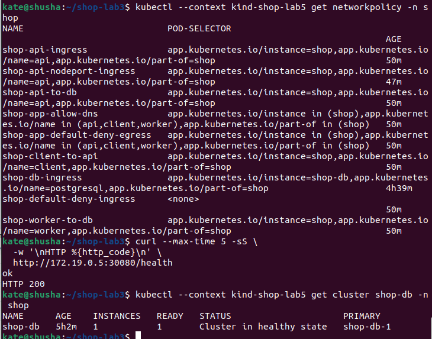

## Часть 5 — Докажи матрицу на практике

Для доказательства эффективности политик была проведена практическая проверка связности между всеми подами кластера, включая обращения от изолированного постороннего пода shop-outsider. Результаты сведены в таблицу фактического прохождения трафика:

| Маршрут проверки | Протокол / Порт | Ожидание | Фактический результат | Статус проверки |
| :--- | :--- | :--- | :--- | :--- |
| chaos-client -> shop-api | TCP / 8000 | Разрешено | HTTP 200 OK | PASS (Зеленый) |
| chaos-client -> shop-worker | TCP / 8081 | Запрещено | TimeoutError (Соединение заблокировано) | PASS (Зеленый) |
| chaos-client -> shop-db | TCP / 5432 | Запрещено | TimeoutError (Соединение заблокировано) | PASS (Зеленый) |
| shop-api -> shop-db | TCP / 5432 | Разрешено | TCP Connected (Успешное подключение) | PASS (Зеленый) |
| shop-api -> shop-worker | TCP / 8081 | Запрещено | TimeoutError (Соединение заблокировано) | PASS (Зеленый) |
| shop-worker -> shop-db | TCP / 5432 | Разрешено | TCP Connected (Успешное подключение) | PASS (Зеленый) |
| shop-worker -> shop-api | TCP / 8000 | Запрещено | TimeoutError (Соединение заблокировано) | PASS (Зеленый) |
| shop-outsider -> shop-db | TCP / 5432 | Запрещено | Policy Denied DROPPED (Сброшено ядром) | PASS (Зеленый) |
| shop-outsider -> shop-api | TCP / 8000 | Запрещено | Policy Denied DROPPED (Сброшено ядром) | PASS (Зеленый) |
| shop-outsider -> shop-worker | TCP / 8081 | Запрещено | Policy Denied DROPPED (Сброшено ядром) | PASS (Зеленый) |

Положительные проверки подтвердили штатное прохождение легитимного трафика: сервис API и фоновый worker беспрепятственно подключаются к порту 5432 СУБД PostgreSQL:

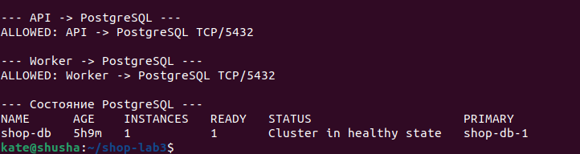

Отрицательные проверки доказали надежность Zero Trust: попытки несанкционированного подключения к БД от постороннего пода shop-outsider завершились таймаутом. Подсистема наблюдения Hubble CLI подтвердила, что отказ вызван именно применением сетевой политики, зафиксировав события INGRESS DENIED и Policy denied DROPPED на порту 5432:

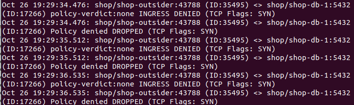

В графическом интерфейсе Hubble UI сброшенные сетевые пакеты отображаются наглядными красными линиями со статусом dropped:

## Часть 6 — Найди скрытую поломку связности

В Helm-чарте реализовано 4 сценария внесения скрытых сетевых поломок через values.yaml:

1) wrong-api-db-port (подмена порта базы в правиле);

2) wrong-worker-db-label (ошибка в метках селектора);

3) block-dns (блокировка DNS-резолвинга);

4) wrong-client-api-port (неверный порт клиентского доступа).

В кластер была внесена скрытая неисправность: активирован режим wrong-api-db-port. Клиентские заказы перестали регистрироваться, а эндпоинт /health начал возвращать ошибку 500.

Диагностический путь через сетевую наблюдаемость без перебора гипотез:

- Шаг 1: Анализ карты потоков в Hubble UI (порт 12080). В интерфейсе мгновенно обнаружен красный индикатор сброса пакетов на линии api -> postgresql.
- Шаг 2: Детализация события дропа. Hubble зафиксировал вердикт Policy denied DROPPED: под shop-api пытается отправить TCP-пакет на порт 5432 сервиса базы данных, однако действующая политика egress разрешает трафик только на порт 5433.
- Шаг 3: Сопоставление с конфигурацией. Проверка values.yaml подтвердила подмену порта в правиле egress (порт 5433 вместо 5432).
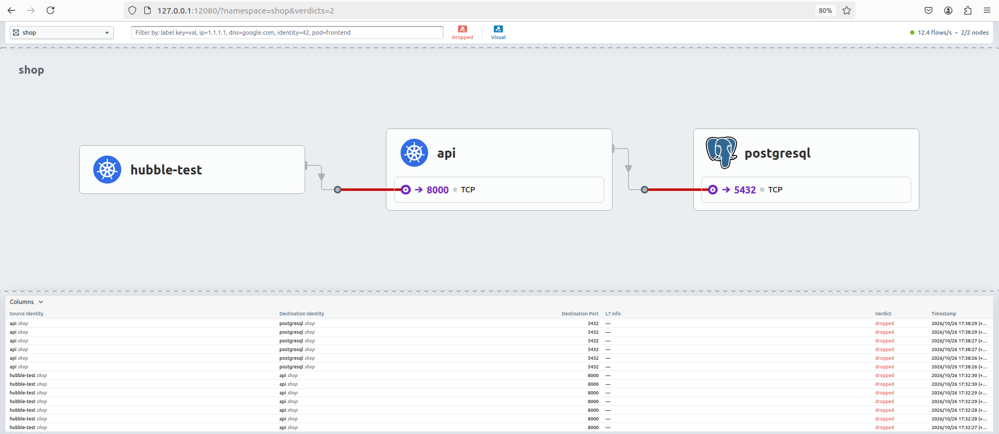

Устранение неисправности: параметр networkPolicy.faultMode возвращен в значение none и выполнен helm upgrade. Сетевая связность восстановилась, эндпоинт /health вернул статус HTTP 200, а матрица доступа снова стала полностью зеленой:

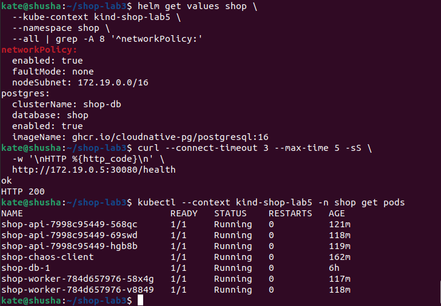

## Часть 7 — Мониторинг

В Helm-чарт shop интегрированы шаблоны ServiceMonitor и PrometheusRule поверх существующего стека мониторинга. Prometheus непрерывно опрашивает метрики приложения и сетевые потоки Cilium/Hubble (все 4 таргета в статусе UP):

Обоснование трех правил алертинга в Prometheus:

- ShopAPIDown (критический): up{job="shop-api"} == 0 в течение 30 секунд. Сигнализирует о полном отказе подов API или невозможности их обнаружения, что ведет к прерыванию обслуживания клиентов.
- ShopAPIHighLatency (предупреждающий): histogram_quantile(0.95, ...) > 0.5s в течение 1 минуты. Детектирует скрытую деградацию производительности и задержек сети до того, как клиенты начнут получать таймауты.
- HubbleDropObserved (безопасность): increase(hubble_drop_total[1m]) > 0. Детектирует всплески трафика, отсекаемого политиками безопасности Cilium. Свидетельствует о попытке несанкционированного доступа или ошибке конфигурации NetworkPolicy.
Провокация срабатывания: при отправке неразрешенных запросов от пода shop-outsider правило HubbleDropObserved зафиксировало сетевые блокировки и мгновенно перешло в активное состояние FIRING:

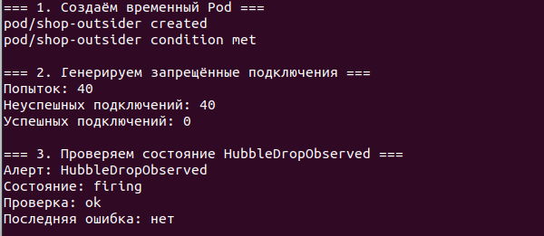

Дашборд Grafana «Shop - Zero Trust Network» визуализирует ключевые эксплуатационные показатели: доступность API, количество целей Hubble, активные алерты, задержки ответов и всплески сетевых сбросов (пик 12.2 drops/5min):

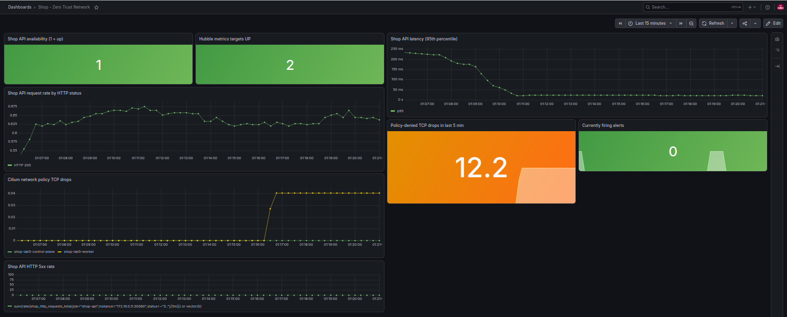

Итоговое состояние развертывания зафиксировано на ревизии 9 Helm-релиза shop в статусе deployed:

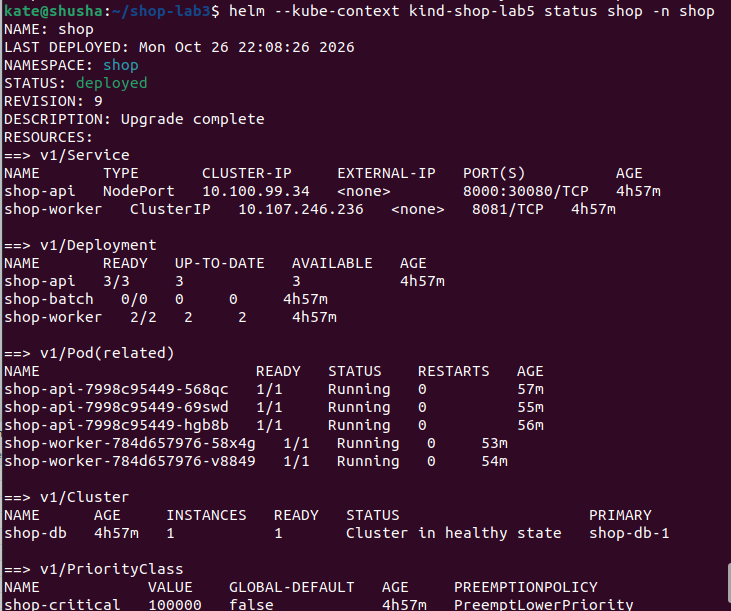

